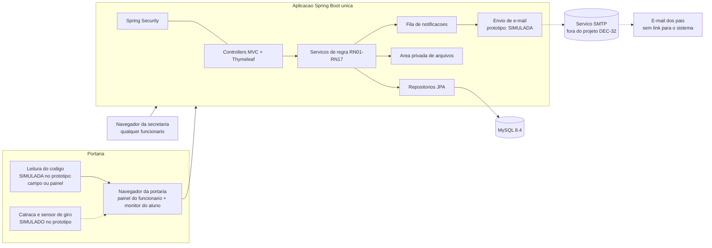
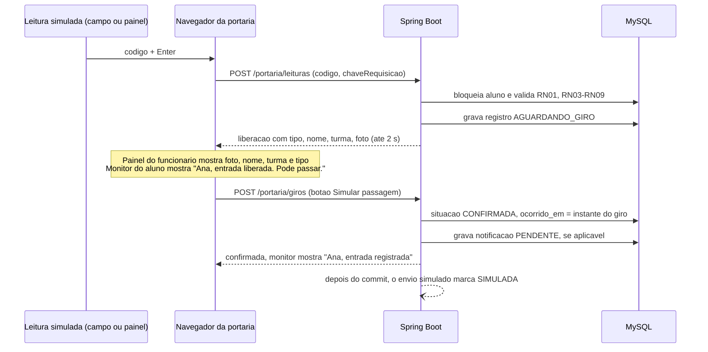
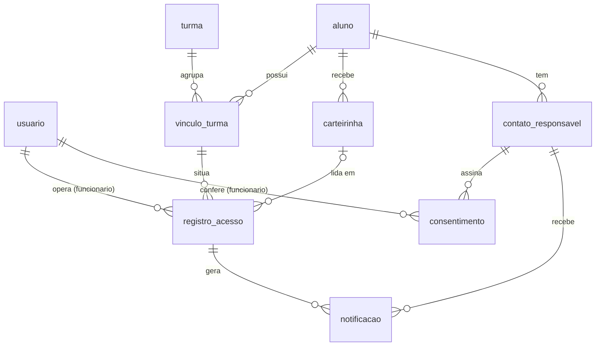

# Arquitetura e dados

**Documentação:** Revisada em 21/10/2026 (DEC-37 a DEC-39) · **Implementação:**
Planejada (nenhum código foi escrito; DDL validado na T-03) · **Atualizado em:** 27/10/2026

A base é a arquitetura da Atividade 13 (A13 p.2–6) e o modelo relacional da
Atividade 14 (A14 p.2–8). Sobre essa base entram as decisões ATU-05 a ATU-07,
DEC-14, DEC-17 a DEC-20 e DEC-37 a DEC-39 (perfil único `FUNCIONARIO`, pais sem
conta). A arquitetura é **proposta para implementação**: o desenvolvimento ainda não
começou (A13 p.2).

## 1. Tecnologias e versões

| Camada | Tecnologia | Versão | Origem | Estado |
|---|---|---|---|---|
| Linguagem | Java | **21 (LTS)** | DEC-17 | Planejada |
| Framework | Spring Boot | **4.1.x**, fixado em **4.1.2** no `pom.xml` na criação do projeto (T-04, 29/10/2026) | DEC-17 | Projeto gerado (T-04) |
| Banco de dados | MySQL | **8.4 (LTS)** | DEC-17; A14 p.9 | Planejada |
| Interface | Thymeleaf, HTML, CSS, JavaScript | Gerenciada pelo Spring Boot | ATU-06; A13 p.3 | Planejada |
| Autenticação e autorização | Spring Security | Gerenciada pelo Spring Boot | ATU-06; A13 p.3 | Planejada |
| E-mail | Spring Mail (SMTP) | Gerenciada pelo Spring Boot | ATU-03, ATU-06; A13 p.3 | Envio **sempre simulado** (DEC-32). O Spring Mail fica só como ponto de extensão |
| Persistência | Spring Data JPA e Bean Validation | Gerenciada pelo Spring Boot | DEC-28 (G1) | Planejada |
| Migrações do banco | Flyway | Gerenciada pelo Spring Boot (12.4.0 no Boot 4.1.2, com o módulo `flyway-mysql`) | DEC-28 (G1) | **Em uso** desde a T-06 (`V1__esquema_inicial.sql`) |
| Geração de QR Code | ZXing | Versão estável mais recente no Maven Central | DEC-28 (G1); DEC-07 | Planejada |
| Build e testes | Maven, JUnit, Spring Boot Test | Gerenciada pelo Spring Boot | ATU-07; A13 p.6 | Planejada |
| Versionamento | GitHub e GitHub Desktop | — | ATU-07; A13 p.6 | Repositório criado: `https://github.com/LuisEduardo77/PI---Furin.git` (DEC-24) |
| Integração contínua | GitHub Actions | — | ATU-07; A13 p.5–6 | **Configurada** na T-05 (`.github/workflows/ci.yml`, §7), com execução verde no PR #4 |
| Análise estática | SonarCloud (SonarQube Cloud) | — | ATU-07; A13 p.6 | **Não configurada** |
| Gestão de tarefas | Trello | — | A13 p.6 | Cartões em [`plano-de-implementacao.md`](plano-de-implementacao.md) |
| Apoio à geração de código | Claude, com revisão do grupo | — | A13 p.6; A10 §8.28 | Previsto |

O Spring Boot 4.1 aceita Java de 17 a 26, então o Java 21 está dentro da faixa. Gere
as dependências pelo **Spring Initializr** para Boot 4.1 e não fixe à mão as versões
que o Boot já gerencia.

## 2. Componentes



| Elemento | Função | Fonte | Estado no protótipo |
|---|---|---|---|
| Navegadores | Só os funcionários (ATE e Gestão Escolar, perfil `FUNCIONARIO`) usam o sistema, com acesso completo. Alunos e pais não têm conta | A13 p.3; DEC-37 | Implementado |
| Leitor USB | Lê o QR Code e digita o código no campo de leitura da portaria, seguido de Enter | A13 p.3; RNF07 | **Simulado** (DEC-25): digitação ou colagem no campo, ou botão do painel "Simular leitura (protótipo)". Não há leitor físico |
| Catraca e sensor de giro | Confirmam a passagem | DEC-18 | **Simulados** por botão |
| Interface web | Login, cadastro, portaria, presentes, histórico e contas da equipe | A13 p.3 | Implementado |
| Backend | Valida, aplica as regras, grava e prepara as notificações. O navegador nunca acessa o banco direto | A13 p.3 | Implementado |
| Spring Security | Autenticação e permissões no servidor: toda rota exige funcionário autenticado e ativo | A13 p.3; A10 §5.15; DEC-37 | Implementado |
| MySQL | Dados estruturados e relacionamentos (seção 5) | A13 p.3; A14 | Implementado |
| Área privada de arquivos | Fotos e termos digitalizados. O banco guarda só a referência | A13 p.3; DEC-08 | Implementado |
| Notificações e serviço SMTP | Aviso depois da confirmação, enviado fora do caminho crítico | A13 p.3–5 | **Simulado** (status `SIMULADA`) |

Decisões de infraestrutura (A13 p.4):

- No protótipo, a aplicação, o banco e os arquivos rodam no **mesmo computador**.
- **Hospedagem (DEC-31):** a aplicação roda **local**. O GitHub Pages serve só páginas
  estáticas (HTML, CSS e JavaScript) e não executa Java, Spring Boot nem MySQL. Por isso
  ele pode publicar, de forma opcional, a **documentação** do projeto, mas não a
  aplicação.
- **E-mail (DEC-32):** sempre simulado. Não há provedor SMTP. Não existe mensagem de
  WhatsApp, nem simulada (DEC-37).
- O GitHub hospeda o código e a CI. **Não** é servidor da aplicação nem do banco.

## 3. Fluxos principais

### 3.1 Leitura, liberação e giro (RF09, RF13–RF15, RF22)



**Detalhes de implementação (DEC-28, G2)**

- **Expiração:** uma tarefa agendada (`@Scheduled`) cancela com `SEM_GIRO` as
  liberações que passaram do prazo. O prazo é de **15 s** (DEC-28, A1). A mesma
  verificação roda antes de cada operação da portaria.
- **Janela de 2 s (RN03):** fica no banco, não na memória.
  - A leitura é ignorada quando já existe um registro da mesma carteirinha com
    `lancado_em` nos últimos 2 s e situação diferente de `CONFIRMADA`.
  - Um registro confirmado significa que houve giro, e isso encerra a janela.
- **Leitura simulada (DEC-25):** no perfil `prototipo`, a página `/portaria` inclui o
  painel "Simular leitura (protótipo)", com as carteirinhas fictícias ativas. Cada
  botão chama a mesma função JavaScript do campo de leitura, que faz o
  `POST /portaria/leituras`. Fora do perfil `prototipo`, o painel não é renderizado.
- **Monitor separado (evolução fora do MVP):** a página `/portaria/monitor` é
  atualizada por Server-Sent Events. No protótipo, o monitor é um painel na mesma
  página [DEC-06].

### 3.2 Registro manual (RF11, RF12)

1. O funcionário busca o aluno.
2. O sistema calcula o tipo (RN01).
3. O funcionário informa o horário real e o motivo.
4. O sistema mostra a confirmação e o funcionário confirma.
5. O registro é gravado como `MANUAL` e `CONFIRMADA`, com `ocorrido_em` (horário
   informado) e `lancado_em` (horário do servidor) [DEC-20].
6. A notificação é criada conforme a RN11.

### 3.3 Notificação (RF21)

1. A notificação é criada na mesma transação da confirmação, com status `PENDENTE`.
2. Depois do commit, um processo assíncrono faz o envio:
   - perfil `prototipo` → `SIMULADA`;
   - envio real (`ENVIADA` ou `FALHA`, até **3** tentativas): **fora do projeto**
     (DEC-32). O serviço de envio fica atrás de uma interface, para uma evolução futura.
3. Uma falha não altera a movimentação (A10 §8.26; A13 p.5).
4. O e-mail não tem link para o sistema. Os pais pedem à escola para deixar de receber,
   e um funcionário muda a opção na edição do aluno (RF08, DEC-38).

### 3.4 Consulta do responsável (RF24) *(fora do escopo)*

Saiu com a DEC-37: os pais/responsáveis não têm conta. Não criar pacote, rota, tela
nem tabela para isso.

## 4. Organização do código e configuração (DEC-28, G2)

```
furin-access/
├── README.md
├── docs/  ·  requirements/          # esta documentação
├── pom.xml
├── scripts/                       # backup.ps1, backup.sh (DEC-30)
├── .github/workflows/ci.yml
└── src/
    ├── main/java/br/com/furin/access/
    │   ├── config/        # segurança, perfis, propriedades furin.*
    │   ├── autenticacao/  # RF01–RF03, troca de senha, RN14
    │   ├── aluno/         # RF04–RF08: aluno, turma, vínculo, contato, consentimento
    │   ├── carteirinha/   # RF06, RF07, RN15
    │   ├── portaria/      # RF09–RF15, RF22, RF23, RN01–RN09
    │   ├── presenca/      # RF16, RN12
    │   ├── historico/     # RF18–RF20
    │   ├── notificacao/   # RF21, RN11
    │   ├── conta/         # RF26 (contas da equipe)
    │   ├── arquivo/       # área privada (DEC-08)
    │   ├── auditoria/     # log de eventos (A10 §8.15)
    │   └── carga/         # carga fictícia V2, só no perfil prototipo (T-11)
    ├── main/resources/
    │   ├── application.yml, application-prototipo.yml
    │   ├── db/migration/  # V1__esquema_inicial.sql, V3__chave_do_giro.sql (a V2 é a migração Java carga/V2__CargaFicticia)
    │   ├── templates/     # Thymeleaf (layout/base.html: layout-base, T-08)
    │   └── static/        # css (css/base.css, T-08), js
    └── test/java/...
```

### Layout-base (T-08)

Cada tela usa o fragmento `layout/base :: pagina(titulo, menuAtivo, conteudo)`, que
monta o título "Tela | Furin Access", `lang="pt-BR"`, o link "Ir para o conteúdo
principal", o cabeçalho e o menu único do RF03. O "Sair" é um formulário `POST /logout`
com o token CSRF. Sem dependência nova: só fragmentos do Thymeleaf. Detalhes escolhidos
na implementação [PROP]:

- cores além da paleta de A11 (§5.11.3, §5.11.4): erro `#A4161A`, sucesso `#1E5E2E` e
  fundo das mensagens `#F1F4F6`, conferidas pelo teste `EstiloBaseTests`;
- formulários com `novalidate`: o campo continua com `required` e "(obrigatório)", mas o
  erro descritivo vem do servidor (Bean Validation), com `aria-invalid` e
  `aria-describedby`;
- a página `/exemplo/layout` (pacote `exemplo`) é **temporária**: sai quando existir a
  primeira tela real;
- os testes leem as páginas com o HtmlUnit (escopo `test`, versão gerenciada pelo
  Spring Boot).

### Perfis de execução

| Perfil | Uso |
|---|---|
| `prototipo` (padrão) | Notificação `SIMULADA`, painel "Simular leitura", botão "Simular passagem", carga fictícia, HTTP local. Sem WhatsApp (DEC-37) |
| `smtp` | **Fora do projeto** (DEC-32). Não é criado no MVP |
| `test` | Testes automatizados |

### Parâmetros

Todo parâmetro fica configurável e nunca escrito direto no código. Os valores abaixo
foram definidos pelo grupo (DEC-28 e anteriores). Os nomes das propriedades são
sugestões [PROP] e podem ser ajustados na implementação, mantendo esta tabela
atualizada.

| Propriedade | Valor | Fonte |
|---|---|---|
| `furin.escola.nome` | Texto do cabeçalho do relatório. **No repositório, só valor fictício** (por exemplo, "Escola Exemplo"). O valor da implantação é configurado no ambiente, fora do repositório | RF20; A10 §8.33 |
| `furin.escola.fuso` | America/Sao_Paulo | RN10 [PROP: nome] |
| `furin.portaria.janela-repeticao` | 2 s | DEC-02 |
| `furin.portaria.tempo-resposta-max` | 2 s (meta de desempenho) | A08 RNF02 |
| `furin.portaria.prazo-giro` | 15 s | PEND-01 → DEC-28 (A1) |
| `furin.portaria.monitor-exibicao` | 4 s | PEND-12 → DEC-28 (A6) |
| `furin.portaria.painel-limpeza` | 60 s sem leitura | RF10; DEC-28 (A7) |
| `furin.portaria.verificacao-expiracao` | 1 s: intervalo da tarefa agendada que cancela as liberações sem giro | T-29; RN02 [PROP: nome e valor] |
| `furin.carteirinha.tentativas-colisao` | 3 | RF06; DEC-28 (D7) |
| `furin.carteirinha.tamanho-codigo` | 32 (par) | A14 p.6; RN15 [PROP: nome] |
| `furin.presentes.intervalo-atualizacao` | 30 s | RF16; DEC-28 (C2) |
| `furin.busca.max-resultados`, `furin.busca.tamanho-minimo-nome` | 20; 2 caracteres | RF11; DEC-28 (C4) |
| `furin.historico.tamanho-pagina`, `furin.historico.periodo-max-dias` | 50; 31 dias | RF18; DEC-28 (C5) |
| `furin.relatorio.max-registros` | 1.000 | RF20; DEC-28 (C6) |
| `furin.senha.validade-temporaria` | 72 h | DEC-21 |
| `furin.senha.tamanho-temporaria`, `furin.senha.tamanho-minimo` | 12; 8 | PEND-11 → DEC-28 (E4) |
| `furin.login.max-tentativas`, `furin.login.bloqueio` | 5; 15 min | PEND-04 → DEC-28 (E2) |
| `furin.sessao.inatividade` | 30 min | PEND-04 → DEC-28 (E2) |
| `furin.sessao.aviso-antes` | 60 s (mínimo de A11: 20 s) | A11 §5.16.2; DEC-28 (E2) |
| `furin.notificacao.max-tentativas` | 3 | PEND-13 → DEC-28 (F1) |
| `furin.termo.versao-atual` | `v1-2026` | RF05; DEC-26 |
| `furin.contato.ddi` | 55 | RF04 (telefone com DDI e DDD) [PROP: nome] |
| `furin.arquivos.diretorio` | caminho fora do projeto e fora de `static/` | DEC-08 |
| `furin.arquivos.foto.tipos`, `furin.arquivos.foto.tamanho-max` | JPEG, PNG; 2 MB | PEND-05 → DEC-28 (D1) |
| `furin.arquivos.termo.tipos`, `furin.arquivos.termo.tamanho-max` | PDF, JPEG, PNG; 5 MB | PEND-05 → DEC-28 (D2) |
| `furin.retencao.anos` | 5 (o descarte automático fica fora do MVP) | PEND-16 → DEC-36 |

Ficam **fora** da tabela os segredos, que vêm de variáveis de ambiente: senhas iniciais
da carga, credenciais do banco, token do SonarCloud (seção 6).

**Implementação (T-07, 29/10/2026):** `br.com.furin.access.config.FurinProperties`, com
os valores só no `application.yml`. A aplicação não sobe se faltar um valor ou se ele for
inválido (Bean Validation). Qualquer valor pode ser trocado pelo ambiente, por exemplo
`FURIN_ESCOLA_NOME` ou `FURIN_ARQUIVOS_DIRETORIO`. Detalhes escolhidos na implementação
[PROP]:

- os tempos usam o formato de duração do Spring (`2s`, `15m`, `72h`) e os tamanhos, o de
  tamanho (`2MB`, `5MB`);
- os tipos de arquivo ficam como tipos MIME: `image/jpeg`, `image/png` e
  `application/pdf`;
- `furin.arquivos.diretorio` tem o padrão `${user.home}/furin-access/arquivos` e precisa
  ser um caminho absoluto fora do projeto (DEC-08);
- além de "maior que zero", as validações seguem só o que já está documentado:
  `furin.sessao.aviso-antes` de pelo menos 20 s (A11 §5.16.2) e menor que
  `furin.sessao.inatividade`, e `furin.termo.versao-atual` com até 30 caracteres
  (`consentimento.versao_termo`).

### Rotas principais

| Rota | Perfil | RF |
|---|---|---|
| `GET/POST /login`, `POST /logout` | público / autenticado | RF01–RF03 |
| `GET/POST /senha/definir` | FUNCIONARIO | RF01, RN14 |
| `GET/POST /senha/alterar` | FUNCIONARIO | RF01 (fluxo A3) |
| `POST /sessao/renovar` | FUNCIONARIO | RF01 (fluxo A2, "Continuar conectado"; T-16) [PROP] |
| `GET /portaria` | FUNCIONARIO | RF09–RF16, RF22, RF23 |
| `POST /portaria/leituras` | FUNCIONARIO | RF09, RF13–RF15 |
| `POST /portaria/giros` (só no perfil `prototipo`) | FUNCIONARIO | RF09, RF14 |
| `POST /portaria/liberacoes/{id}/cancelar` | FUNCIONARIO | RN02 (DEC-28, A2) |
| `GET /portaria/liberacoes/{id}` | FUNCIONARIO | RF09, fluxo A1: situação da liberação, para a tela mostrar a expiração [PROP] |
| `GET/POST /portaria/manual` | FUNCIONARIO | RF11, RF12. Na T-32: `GET /portaria/manual` (busca), `GET /portaria/manual/{idAluno}` (formulário), `POST /portaria/manual/{idAluno}/revisar`, `POST /portaria/manual/{idAluno}/corrigir` e `POST /portaria/manual/{idAluno}` (gravação) [PROP] |
| `GET /alunos` (busca, com `termo` e `inativos`), `POST /alunos`, `GET /alunos/novo` [PROP], `GET/POST /alunos/{id}/editar` e `POST /alunos/{id}/editar/revisar` [PROP] (inclui o aviso por e-mail, DEC-38), `GET/POST /alunos/{id}/inativacao` [PROP] | FUNCIONARIO | RF04–RF06, RF08 |
| `POST /alunos/{id}/carteirinhas`, `GET /carteirinhas/{id}/imprimir`, `GET /carteirinhas/{id}/qr-code` [PROP] e `GET /alunos/{id}/carteirinhas/segunda-via` (confirmação, até a página do aluno) [PROP] | FUNCIONARIO | RF07 |
| `GET/POST /alunos/{id}/consentimentos/{idConsentimento}/revogacao` (o GET é a tela própria até a T-23 [PROP]) | FUNCIONARIO | RF05 (DEC-34) |
| `GET /arquivos/{chave}` | FUNCIONARIO | DEC-08 |
| `GET /presentes` | FUNCIONARIO | RF16. Na T-34, a tela pede a mesma rota de novo a cada `furin.presentes.intervalo-atualizacao`, com o cabeçalho `X-Furin-Atualizacao-Automatica` [PROP]: o filtro `autenticacao/AtualizacaoAutomatica` não conta esse pedido como atividade, e a sessão expira por inatividade do mesmo jeito (T-16). A resposta de `POST /portaria/giros` traz também `presentes` (total e turma) para o contador da portaria [PROP] |
| `GET /historico` | FUNCIONARIO | RF18–RF20 |
| `GET /historico/impressao` [PROP] | FUNCIONARIO | RF20 (T-36) |
| `/contas/equipe/**`: `GET /contas/equipe`, `GET /contas/equipe/nova`, `POST /contas/equipe`, `GET /contas/equipe/senha-temporaria` e `GET/POST /contas/equipe/{id}/nova-senha`, `…/desativacao` e `…/reativacao` [PROP] | FUNCIONARIO | RF26 (DEC-39; T-43) |

Não existem as rotas `/responsavel/**` nem `/contas/responsaveis/**` (RF24 e RF25 fora
do escopo, DEC-37). Sem login, toda rota (menos `/login`) leva à tela de login.
Qualquer rota não listada é **negada por padrão** (A10 §5.15).

## 5. Modelo de dados

### 5.1 Convenções [DOC A14]

- Modelo relacional em MySQL [ATU-05].
- PKs `BIGINT UNSIGNED AUTO_INCREMENT`.
- Datas em `DATETIME(6)`, gravadas em UTC e exibidas no fuso America/Sao_Paulo.
- `BOOLEAN` com `CHECK` em 0 ou 1.
- Textos obrigatórios não podem ser vazios.
- Totais de presença e primeiro nome são calculados, nunca gravados.
- Nada é apagado fisicamente: a inativação preserva o histórico.

### 5.2 Ajuste mínimo aprovado [DEC-14]

| Tabela | Alteração em relação à A14 | Origem | Situação |
|---|---|---|---|
| `usuario` | `perfil` passa a aceitar só `FUNCIONARIO` (VARCHAR(15)). A A14 previa `ATE` e `GESTAO` | DEC-37 (substitui ATU-04, DEC-10) | Aprovada |
| `usuario` | `login` fica com VARCHAR(80), como na A14. O aumento para 254 servia ao login por e-mail dos responsáveis | DEC-37 (substitui DEC-28, E3) | Aprovada |
| `usuario` | Novos campos `troca_senha_obrigatoria` e `senha_temporaria_expira_em` | DEC-21 | Aprovada |
| `aluno` | `foto_chave` passa a NOT NULL (A14 dizia "opcional, confirmar") | DEC-05 | Aprovada |
| `contato_responsavel` | Novos campos `principal`, `recebe_notificacao` (padrão 1) e a coluna gerada `principal_aluno` (UNIQUE). Os campos de conta e vínculo (`id_usuario`, `vinculo_confirmado_em`, `id_usuario_confirmador`) **saíram** | DEC-09, DEC-22, DEC-37, DEC-38 | Aprovada. A técnica da coluna gerada foi aprovada na T-00 (DEC-28, G2) |
| `contato_responsavel` | Volta a valer "Não cria acesso ao sistema", como na A14 | DEC-37 | Aprovada |
| `registro_acesso` | `tipo` deixa de ser "escolhido na interface" e passa a ser **definido pelo servidor** | ATU-01, DEC-01 | Aprovada |
| `registro_acesso` | `MANUAL` passa a valer para `ENTRADA` e `SAIDA` | DEC-03 | Aprovada |
| `registro_acesso` | Novos campos `situacao`, `lancado_em`, `cancelado_em`, `motivo_cancelamento` e a coluna gerada `pendente_vinculo` (UNIQUE). `ocorrido_em` passa a ser condicional | DEC-19, DEC-20 | Aprovada. Cancelamento pelo funcionário aprovado na T-00 (DEC-28, A2), com o valor `FUNCIONARIO` (DEC-37) |
| `notificacao` | **Nova tabela** | ATU-02, ATU-03 | Aprovada |
| `turma`, `vinculo_turma`, `carteirinha`, `consentimento` | Sem alteração | A14 p.5–7 | — |

**Alternativa não adotada:** criar uma entidade `pessoa_responsavel` com associação N:N
com os alunos (A14 p.4). O grupo escolheu o ajuste mínimo. Irmãos têm um contato
cada um, com os mesmos dados do responsável.

### 5.3 Diagrama



### 5.4 Dicionário das tabelas alteradas e da tabela nova

As tabelas sem alteração (`turma`, `vinculo_turma`, `carteirinha`, `consentimento`)
seguem o dicionário de A14 p.5–7. Elas também estão no DDL da seção 5.5.

**`usuario`**: contas individuais dos funcionários (ATE e Gestão Escolar), todas com o
perfil `FUNCIONARIO` (DEC-37).

| Atributo | Tipo | Obrig. | Observações |
|---|---|---|---|
| id_usuario | BIGINT UNSIGNED | Sim | PK |
| nome | VARCHAR(150) | Sim | — |
| login | VARCHAR(80) | Sim | UK. Normalizado (sem espaços nas pontas, em minúsculas) |
| senha_hash | VARCHAR(255) | Sim | Hash com salt (RNF03) |
| perfil | VARCHAR(15) | Sim | Sempre `FUNCIONARIO` (DEC-37). A coluna fica para uma evolução futura |
| ativo | BOOLEAN | Sim | Padrão 1. Conta inativa não autentica |
| troca_senha_obrigatoria | BOOLEAN | Sim | Padrão 0 |
| senha_temporaria_expira_em | DATETIME(6) | Não | Momento da emissão + 72 h. Só existe com `troca_senha_obrigatoria = 1` |
| criado_em | DATETIME(6) | Sim | Atribuído pelo servidor |

**`aluno`**: alteração.

| Atributo | Tipo | Obrig. | Observações |
|---|---|---|---|
| foto_chave | VARCHAR(255) | **Sim** | Chave do arquivo na área privada. Não é uma URL pública |

**`contato_responsavel`**

| Atributo | Tipo | Obrig. | Observações |
|---|---|---|---|
| id_contato | BIGINT UNSIGNED | Sim | PK |
| id_aluno | BIGINT UNSIGNED | Sim | FK `aluno` |
| nome | VARCHAR(150) | Sim | — |
| telefone | VARCHAR(25) | Cond. | Obrigatório no contato principal (para a escola entrar em contato, fora do sistema) |
| email | VARCHAR(254) | Cond. | Obrigatório no contato principal (notificação) |
| ativo | BOOLEAN | Sim | Padrão 1 |
| principal | BOOLEAN | Sim | Padrão 0. Um contato principal ativo por aluno |
| recebe_notificacao | BOOLEAN | Sim | Padrão **1**. Um funcionário altera a pedido do responsável (DEC-38) |
| principal_aluno | gerada | — | `id_aluno` se `principal = 1 AND ativo = 1`. UNIQUE |

**`registro_acesso`**

| Atributo | Tipo | Obrig. | Observações |
|---|---|---|---|
| id_registro | BIGINT UNSIGNED | Sim | PK |
| id_vinculo | BIGINT UNSIGNED | Sim | FK. Define o aluno e a turma no evento |
| id_usuario | BIGINT UNSIGNED | Sim | FK. Funcionário autenticado |
| id_carteirinha | BIGINT UNSIGNED | Cond. | Obrigatório em LEITURA. NULL em MANUAL |
| tipo | VARCHAR(7) | Sim | `ENTRADA` ou `SAIDA`, definido pelo servidor |
| forma | VARCHAR(7) | Sim | `LEITURA` ou `MANUAL` |
| situacao | VARCHAR(15) | Sim | `AGUARDANDO_GIRO`, `CONFIRMADA` ou `CANCELADA` |
| lancado_em | DATETIME(6) | Sim | Momento em que o servidor recebeu a operação |
| ocorrido_em | DATETIME(6) | Cond. | Só em `CONFIRMADA`. LEITURA = instante do giro. MANUAL = horário informado |
| cancelado_em | DATETIME(6) | Cond. | Só em `CANCELADA` |
| motivo_cancelamento | VARCHAR(15) | Cond. | `SEM_GIRO` ou `FUNCIONARIO` (PEND-03, DEC-37) |
| chave_requisicao | CHAR(36) | Sim | UK. UUID da operação |
| chave_giro | CHAR(36) | Cond. | UK. UUID do giro que confirmou a liberação (V3, DEC-41) |
| motivo_manual | VARCHAR(200) | Cond. | Obrigatório em MANUAL |
| pendente_vinculo | gerada | — | `id_vinculo` se `AGUARDANDO_GIRO`. UNIQUE |
| pendente_ponto | gerada | — | `1` se `AGUARDANDO_GIRO`. UNIQUE: uma liberação pendente por vez no ponto de leitura (V4, DEC-46; RN05) |

As telas comuns usam **somente** `situacao = 'CONFIRMADA'`. Os registros cancelados
ficam guardados para rastreabilidade (A10 §8.15).

**`notificacao`**: tabela nova.

| Atributo | Tipo | Obrig. | Observações |
|---|---|---|---|
| id_notificacao | BIGINT UNSIGNED | Sim | PK |
| id_registro | BIGINT UNSIGNED | Sim | FK `registro_acesso` (só confirmadas, conferido pela aplicação) |
| id_contato | BIGINT UNSIGNED | Sim | FK `contato_responsavel` |
| canal | VARCHAR(10) | Sim | `EMAIL` |
| status | VARCHAR(10) | Sim | `PENDENTE`, `ENVIADA`, `FALHA` ou `SIMULADA` |
| tentativas | TINYINT UNSIGNED | Sim | Padrão 0 |
| criado_em | DATETIME(6) | Sim | — |
| ultima_tentativa_em | DATETIME(6) | Não | — |

UNIQUE(`id_registro`, `id_contato`). O corpo do e-mail **não** é guardado, por
minimização (A10 §5.34).

### 5.5 DDL de referência (DEC-28, G2)

> **Estado:** **validado na T-03, em 27/10/2026**, no MySQL 8.4.13: as 9 tabelas foram
> criadas sem erro, e os CHECKs, UNIQUEs e FKs passaram em 86 de 86 casos de teste, sem
> nenhuma alteração neste DDL. Scripts e saída em
> [`evidencias/t-03/`](evidencias/t-03/README.md). Se o DDL mudar, rode os scripts de novo.
>
> **Migração:** desde a T-06 (29/10/2026), este DDL é a migração
> `src/main/resources/db/migration/V1__esquema_inicial.sql`, copiada sem alteração. A V1
> não é editada depois de aplicada: uma mudança no esquema entra em uma migração nova
> (V2, V3…) e precisa ser refletida aqui.

```sql
CREATE TABLE usuario (
  id_usuario                  BIGINT UNSIGNED NOT NULL AUTO_INCREMENT,
  nome                        VARCHAR(150)    NOT NULL,
  login                       VARCHAR(80)     NOT NULL,
  senha_hash                  VARCHAR(255)    NOT NULL,
  perfil                      VARCHAR(15)     NOT NULL,
  ativo                       BOOLEAN         NOT NULL DEFAULT 1,
  troca_senha_obrigatoria     BOOLEAN         NOT NULL DEFAULT 0,
  senha_temporaria_expira_em  DATETIME(6)     NULL,
  criado_em                   DATETIME(6)     NOT NULL,
  PRIMARY KEY (id_usuario),
  UNIQUE KEY uk_usuario_login (login),
  CONSTRAINT ck_usuario_nome   CHECK (TRIM(nome) <> ''),
  CONSTRAINT ck_usuario_login  CHECK (TRIM(login) <> ''),
  CONSTRAINT ck_usuario_perfil CHECK (perfil IN ('FUNCIONARIO')),
  CONSTRAINT ck_usuario_bools  CHECK (ativo IN (0,1) AND troca_senha_obrigatoria IN (0,1)),
  CONSTRAINT ck_usuario_temp   CHECK (senha_temporaria_expira_em IS NULL OR troca_senha_obrigatoria = 1)
) ENGINE=InnoDB DEFAULT CHARSET=utf8mb4 COLLATE=utf8mb4_0900_ai_ci;

CREATE TABLE turma (
  id_turma    BIGINT UNSIGNED   NOT NULL AUTO_INCREMENT,
  nome        VARCHAR(30)       NOT NULL,
  ano_letivo  SMALLINT UNSIGNED NOT NULL,
  turno       VARCHAR(10)       NOT NULL,
  ativa       BOOLEAN           NOT NULL DEFAULT 1,
  PRIMARY KEY (id_turma),
  UNIQUE KEY uk_turma (nome, ano_letivo, turno),
  CONSTRAINT ck_turma_nome  CHECK (TRIM(nome) <> ''),
  CONSTRAINT ck_turma_ano   CHECK (ano_letivo BETWEEN 2000 AND 2199),
  CONSTRAINT ck_turma_turno CHECK (turno IN ('MANHA','TARDE','INTEGRAL','NOITE')),
  CONSTRAINT ck_turma_ativa CHECK (ativa IN (0,1))
) ENGINE=InnoDB DEFAULT CHARSET=utf8mb4 COLLATE=utf8mb4_0900_ai_ci;

CREATE TABLE aluno (
  id_aluno    BIGINT UNSIGNED NOT NULL AUTO_INCREMENT,
  matricula   VARCHAR(30)     NOT NULL,
  nome        VARCHAR(150)    NOT NULL,
  foto_chave  VARCHAR(255)    NOT NULL,
  ativo       BOOLEAN         NOT NULL DEFAULT 1,
  criado_em   DATETIME(6)     NOT NULL,
  PRIMARY KEY (id_aluno),
  UNIQUE KEY uk_aluno_matricula (matricula),
  CONSTRAINT ck_aluno_matricula CHECK (TRIM(matricula) <> ''),
  CONSTRAINT ck_aluno_nome      CHECK (TRIM(nome) <> ''),
  CONSTRAINT ck_aluno_foto      CHECK (TRIM(foto_chave) <> ''),
  CONSTRAINT ck_aluno_ativo     CHECK (ativo IN (0,1))
) ENGINE=InnoDB DEFAULT CHARSET=utf8mb4 COLLATE=utf8mb4_0900_ai_ci;

CREATE TABLE vinculo_turma (
  id_vinculo  BIGINT UNSIGNED NOT NULL AUTO_INCREMENT,
  id_aluno    BIGINT UNSIGNED NOT NULL,
  id_turma    BIGINT UNSIGNED NOT NULL,
  inicio_em   DATETIME(6)     NOT NULL,
  fim_em      DATETIME(6)     NULL,
  PRIMARY KEY (id_vinculo),
  UNIQUE KEY uk_vinculo_inicio (id_aluno, inicio_em),
  CONSTRAINT fk_vinculo_aluno FOREIGN KEY (id_aluno) REFERENCES aluno (id_aluno),
  CONSTRAINT fk_vinculo_turma FOREIGN KEY (id_turma) REFERENCES turma (id_turma),
  CONSTRAINT ck_vinculo_periodo CHECK (fim_em IS NULL OR fim_em > inicio_em)
) ENGINE=InnoDB DEFAULT CHARSET=utf8mb4 COLLATE=utf8mb4_0900_ai_ci;

CREATE TABLE carteirinha (
  id_carteirinha  BIGINT UNSIGNED NOT NULL AUTO_INCREMENT,
  id_aluno        BIGINT UNSIGNED NOT NULL,
  codigo          CHAR(32) CHARACTER SET ascii COLLATE ascii_bin NOT NULL,
  emitida_em      DATETIME(6)     NOT NULL,
  expira_em       DATETIME(6)     NULL,
  revogada_em     DATETIME(6)     NULL,
  PRIMARY KEY (id_carteirinha),
  UNIQUE KEY uk_carteirinha_codigo (codigo),
  CONSTRAINT fk_carteirinha_aluno FOREIGN KEY (id_aluno) REFERENCES aluno (id_aluno),
  CONSTRAINT ck_carteirinha_expira CHECK (expira_em IS NULL OR expira_em > emitida_em),
  CONSTRAINT ck_carteirinha_revoga CHECK (revogada_em IS NULL OR revogada_em >= emitida_em)
) ENGINE=InnoDB DEFAULT CHARSET=utf8mb4 COLLATE=utf8mb4_0900_ai_ci;

CREATE TABLE contato_responsavel (
  id_contato              BIGINT UNSIGNED NOT NULL AUTO_INCREMENT,
  id_aluno                BIGINT UNSIGNED NOT NULL,
  nome                    VARCHAR(150)    NOT NULL,
  telefone                VARCHAR(25)     NULL,
  email                   VARCHAR(254)    NULL,
  ativo                   BOOLEAN         NOT NULL DEFAULT 1,
  principal               BOOLEAN         NOT NULL DEFAULT 0,
  recebe_notificacao      BOOLEAN         NOT NULL DEFAULT 1,
  principal_aluno         BIGINT UNSIGNED
      GENERATED ALWAYS AS (CASE WHEN principal = 1 AND ativo = 1 THEN id_aluno END) STORED,
  PRIMARY KEY (id_contato),
  UNIQUE KEY uk_contato_principal (principal_aluno),
  CONSTRAINT fk_contato_aluno     FOREIGN KEY (id_aluno) REFERENCES aluno (id_aluno),
  CONSTRAINT ck_contato_nome      CHECK (TRIM(nome) <> ''),
  CONSTRAINT ck_contato_algum     CHECK (COALESCE(TRIM(telefone),'') <> '' OR COALESCE(TRIM(email),'') <> ''),
  CONSTRAINT ck_contato_principal CHECK (principal = 0
      OR (COALESCE(TRIM(telefone),'') <> '' AND COALESCE(TRIM(email),'') <> '')),
  CONSTRAINT ck_contato_bools     CHECK (ativo IN (0,1) AND principal IN (0,1) AND recebe_notificacao IN (0,1))
) ENGINE=InnoDB DEFAULT CHARSET=utf8mb4 COLLATE=utf8mb4_0900_ai_ci;

CREATE TABLE consentimento (
  id_consentimento       BIGINT UNSIGNED NOT NULL AUTO_INCREMENT,
  id_contato             BIGINT UNSIGNED NOT NULL,
  versao_termo           VARCHAR(30)     NOT NULL,
  assinado_em            DATE            NOT NULL,
  referencia_termo       VARCHAR(255)    NOT NULL,
  id_usuario_conferente  BIGINT UNSIGNED NOT NULL,
  conferido_em           DATETIME(6)     NOT NULL,
  revogado_em            DATETIME(6)     NULL,
  PRIMARY KEY (id_consentimento),
  CONSTRAINT fk_consent_contato    FOREIGN KEY (id_contato) REFERENCES contato_responsavel (id_contato),
  CONSTRAINT fk_consent_conferente FOREIGN KEY (id_usuario_conferente) REFERENCES usuario (id_usuario),
  CONSTRAINT ck_consent_versao CHECK (TRIM(versao_termo) <> ''),
  CONSTRAINT ck_consent_ref    CHECK (TRIM(referencia_termo) <> ''),
  CONSTRAINT ck_consent_revoga CHECK (revogado_em IS NULL OR revogado_em >= conferido_em)
) ENGINE=InnoDB DEFAULT CHARSET=utf8mb4 COLLATE=utf8mb4_0900_ai_ci;

CREATE TABLE registro_acesso (
  id_registro          BIGINT UNSIGNED NOT NULL AUTO_INCREMENT,
  id_vinculo           BIGINT UNSIGNED NOT NULL,
  id_usuario           BIGINT UNSIGNED NOT NULL,
  id_carteirinha       BIGINT UNSIGNED NULL,
  tipo                 VARCHAR(7)      NOT NULL,
  forma                VARCHAR(7)      NOT NULL,
  situacao             VARCHAR(15)     NOT NULL,
  lancado_em           DATETIME(6)     NOT NULL,
  ocorrido_em          DATETIME(6)     NULL,
  cancelado_em         DATETIME(6)     NULL,
  motivo_cancelamento  VARCHAR(15)     NULL,
  chave_requisicao     CHAR(36) CHARACTER SET ascii COLLATE ascii_bin NOT NULL,
  chave_giro           CHAR(36) CHARACTER SET ascii COLLATE ascii_bin NULL,  -- V3, DEC-41
  motivo_manual        VARCHAR(200)    NULL,
  pendente_vinculo     BIGINT UNSIGNED
      GENERATED ALWAYS AS (CASE WHEN situacao = 'AGUARDANDO_GIRO' THEN id_vinculo END) STORED,
  pendente_ponto       TINYINT UNSIGNED  -- V4, DEC-46
      GENERATED ALWAYS AS (CASE WHEN situacao = 'AGUARDANDO_GIRO' THEN 1 END) STORED,
  PRIMARY KEY (id_registro),
  UNIQUE KEY uk_registro_chave (chave_requisicao),
  UNIQUE KEY uk_registro_chave_giro (chave_giro),  -- V3, DEC-41
  UNIQUE KEY uk_registro_pendente (pendente_vinculo),
  UNIQUE KEY uk_registro_pendente_ponto (pendente_ponto),  -- V4, DEC-46
  KEY ix_registro_vinculo (id_vinculo, situacao, ocorrido_em),
  KEY ix_registro_ocorrido (situacao, ocorrido_em),
  CONSTRAINT fk_registro_vinculo     FOREIGN KEY (id_vinculo) REFERENCES vinculo_turma (id_vinculo),
  CONSTRAINT fk_registro_usuario     FOREIGN KEY (id_usuario) REFERENCES usuario (id_usuario),
  CONSTRAINT fk_registro_carteirinha FOREIGN KEY (id_carteirinha) REFERENCES carteirinha (id_carteirinha),
  CONSTRAINT ck_registro_tipo     CHECK (tipo IN ('ENTRADA','SAIDA')),
  CONSTRAINT ck_registro_forma    CHECK (forma IN ('LEITURA','MANUAL')),
  CONSTRAINT ck_registro_situacao CHECK (situacao IN ('AGUARDANDO_GIRO','CONFIRMADA','CANCELADA')),
  CONSTRAINT ck_registro_leitura  CHECK (forma <> 'LEITURA'
      OR (id_carteirinha IS NOT NULL AND motivo_manual IS NULL)),
  CONSTRAINT ck_registro_manual   CHECK (forma <> 'MANUAL'
      OR (id_carteirinha IS NULL AND COALESCE(TRIM(motivo_manual),'') <> '' AND situacao = 'CONFIRMADA')),
  CONSTRAINT ck_registro_ocorrido CHECK ((situacao = 'CONFIRMADA') = (ocorrido_em IS NOT NULL)),
  CONSTRAINT ck_registro_cancel   CHECK ((situacao = 'CANCELADA') = (cancelado_em IS NOT NULL)
      AND (situacao = 'CANCELADA') = (motivo_cancelamento IS NOT NULL)),
  CONSTRAINT ck_registro_motcanc  CHECK (motivo_cancelamento IS NULL OR motivo_cancelamento IN ('SEM_GIRO','FUNCIONARIO')),
  CONSTRAINT ck_registro_horarios CHECK (ocorrido_em IS NULL
      OR (forma = 'MANUAL'  AND ocorrido_em <= lancado_em)
      OR (forma = 'LEITURA' AND ocorrido_em >= lancado_em))
) ENGINE=InnoDB DEFAULT CHARSET=utf8mb4 COLLATE=utf8mb4_0900_ai_ci;

CREATE TABLE notificacao (
  id_notificacao       BIGINT UNSIGNED  NOT NULL AUTO_INCREMENT,
  id_registro          BIGINT UNSIGNED  NOT NULL,
  id_contato           BIGINT UNSIGNED  NOT NULL,
  canal                VARCHAR(10)      NOT NULL DEFAULT 'EMAIL',
  status               VARCHAR(10)      NOT NULL DEFAULT 'PENDENTE',
  tentativas           TINYINT UNSIGNED NOT NULL DEFAULT 0,
  criado_em            DATETIME(6)      NOT NULL,
  ultima_tentativa_em  DATETIME(6)      NULL,
  PRIMARY KEY (id_notificacao),
  UNIQUE KEY uk_notificacao (id_registro, id_contato),
  KEY ix_notificacao_status (status),
  CONSTRAINT fk_notif_registro FOREIGN KEY (id_registro) REFERENCES registro_acesso (id_registro),
  CONSTRAINT fk_notif_contato  FOREIGN KEY (id_contato) REFERENCES contato_responsavel (id_contato),
  CONSTRAINT ck_notif_canal  CHECK (canal IN ('EMAIL')),
  CONSTRAINT ck_notif_status CHECK (status IN ('PENDENTE','ENVIADA','FALHA','SIMULADA'))
) ENGINE=InnoDB DEFAULT CHARSET=utf8mb4 COLLATE=utf8mb4_0900_ai_ci;
```

**Observações**

- O MySQL proíbe `ON DELETE`/`ON UPDATE` com ação nas colunas usadas em CHECK ou em
  colunas geradas. Por isso as FKs mantêm o comportamento padrão.
- Algumas regras envolvem várias tabelas e ficam nos serviços, dentro de transações:
  - cadastro completo (RN16);
  - uma carteirinha válida por aluno (RN15);
  - um vínculo de turma aberto por aluno;
  - sequência de movimentações (RN01);
  - uma liberação por vez no ponto de leitura (RN05), conferida no serviço e garantida
    também pela `uk_registro_pendente_ponto` (V4, DEC-46), porque o bloqueio de cada
    aluno não serializa leituras de alunos diferentes.

### 5.6 Carga fictícia do protótipo (DEC-28, G2)

As senhas iniciais vêm de variáveis de ambiente e **nunca** ficam no repositório
(A10 §5.17, §8.33).

| Login | Nome | Perfil |
|---|---|---|
| `ate.demo` | ATE Demo | FUNCIONARIO |
| `gestao.demo` | Gestão Demo | FUNCIONARIO |

Os pais/responsáveis entram **só como contatos**, sem conta (DEC-37):

| Contato principal | Alunos | Aviso por e-mail |
|---|---|---|
| Carla Teste (`carla.teste@example.com`) | Ana Teste (6A, 000123) e Davi Teste (3B, 000124), que são irmãos (um contato para cada aluno) | Ligado |
| Bruno Exemplo (`bruno.pai@example.com`) | Bia Exemplo (6A, 000200) | Desligado |

**Turmas:** nenhum RF cria ou edita turmas (PEND-14, DEC-28, D3). A carga fictícia
cria as turmas usadas nos exemplos (por exemplo, 3B e 6A, turno MANHA, ano letivo
2026).

**Consentimentos fictícios:** versão `v1-2026` (DEC-26), referência "Protocolo
fictício 0001" e assim por diante.

**Fotos e termos fictícios:** a carga usa imagens geradas (silhueta ou iniciais) e um
termo de exemplo em PDF, nunca fotos ou documentos de pessoas reais (A10 §8.33).

**Implementação (T-11, 01/11/2026):** migração Java do Flyway
`br.com.furin.access.carga.V2__CargaFicticia`, registrada como bean só no perfil
`prototipo`. Ela substitui o `V2__carga_ficticia.sql` previsto, porque o SQL não gera o
hash bcrypt a partir da variável de ambiente nem cria os arquivos fictícios (decisão do
integrante na T-11). Roda uma vez, numa transação, e fica no histórico do Flyway como V2.

- **Senhas:** variáveis `FURIN_SENHA_ATE_DEMO` e `FURIN_SENHA_GESTAO_DEMO` (ou as mesmas
  chaves no `application-local.yml`). Sem elas, ou com menos de
  `furin.senha.tamanho-minimo` caracteres, a aplicação não sobe. Mudar a variável depois
  da primeira partida não muda a senha gravada.
- **Contas:** ativas e **sem troca obrigatória de senha** [PROP], para a demonstração.
- **Contatos:** telefones fictícios `(11) 90000-0001` (Carla) e `(11) 90000-0002`
  (Bruno) [PROP], porque o contato principal exige telefone.
- **Arquivos:** silhuetas PNG geradas no código e um termo de exemplo em PDF (consentimento
  de Ana), gravados em `furin.arquivos.diretorio` com nome UUID. Os consentimentos de Davi
  e Bia usam "Protocolo fictício 0002" e "0003" [PROP].
- **Carteirinhas:** uma por aluno, com código aleatório de 32 caracteres hexadecimais.
- **Uma próxima migração de esquema** recebe a versão 3 em diante: a V2 existe só nos
  bancos do perfil `prototipo`.

**Medição de desempenho:** a carga de 800 alunos e 30 dias de movimentações usada no
RNF02 é gerada por script separado, só para o teste, e não entra na carga padrão
(DEC-28, G4).

## 6. Segurança e acessibilidade na arquitetura

| Tema | Decisão de arquitetura | Fonte |
|---|---|---|
| Permissões | Negar por padrão. Conferir no servidor, em toda requisição, se há funcionário autenticado e ativo | A10 §5.15, §5.34; DEC-37 |
| Senhas | `PasswordEncoder` delegante do Spring Security (bcrypt por padrão) | A10 §5.17; RNF03 |
| Sessão | Formulário de login, nova sessão a cada login, cookie `HttpOnly`/`SameSite=Lax` (e `Secure` com HTTPS), CSRF ligado | A10 §8.5, §8.28 |
| Entrada e saída de dados | Bean Validation no servidor, JPA parametrizado, `th:text` (nunca `th:utext` com dado do usuário) | A10 §8.28 |
| Segredos | Variáveis de ambiente ou `application-local.yml` no `.gitignore`. Na CI, *Secrets* | A10 §5.17; A13 p.6 |
| Logs | Logger de auditoria separado. Sem senhas, sem documentos, e-mail mascarado | A10 §8.15 |
| Arquivos | Diretório privado fora de `static/`, nome em UUID, entrega por controller autorizado | A10 §5.34; DEC-08 |
| HTTPS e TLS | **Planejados.** A demonstração local usa HTTP | RNF04; A10 §8.24 |
| Backup | Script simples (seção 6.1) | A10 §8.13; LGPD art. 46; DEC-30 |
| Retenção e descarte | 5 anos após o fim do tratamento (DEC-33, DEC-36, [RNF05](../requirements/rnf/RNF05.md)). Nada é apagado fisicamente no MVP (seção 5.1) | RNF05; LGPD art. 15, 16 |
| Acessibilidade | Layout-base com `lang="pt-BR"`, link "Ir para o conteúdo principal", foco visível de 3 px, paleta de A11, regiões `role="status"`/`role="alert"` na portaria | A11; RNF06 |

**Implementação da base (T-09, 01/11/2026):** `br.com.furin.access.config.SegurancaConfig`.

- **Rotas:** as rotas da tabela "Rotas principais" (§4) exigem o perfil `FUNCIONARIO`.
  Ficam públicos só `/login` e os arquivos estáticos (`/css/**`, `/js/**`, `/img/**`,
  `/favicon.ico`). Qualquer outra rota é negada (`denyAll`): sem login, o pedido vai ao
  login; com login, recebe 403. Uma rota nova precisa entrar na lista
  `ROTAS_DO_FUNCIONARIO`. O despacho interno de erro (`/error`) é liberado, para que uma
  página inexistente dentro da área do funcionário dê 404 (RF03).
- **CSRF:** ligado (padrão). O "Sair" é `POST /logout` com o token.
- **Senhas:** `PasswordEncoderFactories.createDelegatingPasswordEncoder()` (bcrypt).
- **Sessão:** cookie `HttpOnly` e `SameSite=Lax` (`server.servlet.session.cookie.*`). O
  atributo `Secure` e o HSTS só entram com HTTPS (RNF04, planejado). Nova sessão a cada
  login: padrão do Spring Security (troca do ID da sessão).
- **Cabeçalhos:** os padrões do Spring Security (`X-Content-Type-Options: nosniff`,
  `X-Frame-Options: DENY`, `Cache-Control: no-store`) e mais [PROP]
  `Content-Security-Policy: default-src 'self'; object-src 'none'; base-uri 'self';
  form-action 'self'; frame-ancestors 'none'` e `Referrer-Policy: same-origin`. Por causa
  da CSP, as telas não usam `<script>` nem `style` embutidos: só arquivos em `static/`.
- **Login (T-12, 01/11/2026):** pacote `br.com.furin.access.autenticacao`. `GET /login`
  mostra a tela própria (`templates/autenticacao/login.html`); o `POST /login` é do
  Spring Security, que busca a conta em `ContasDosFuncionarios` (um `UserDetailsService`
  sobre a entidade `Usuario`). O login digitado é normalizado (`strip` e minúsculas) antes
  da busca; a senha não. O perfil vem do banco, e uma conta com `ativo = 0` fica
  desabilitada e não entra. Depois do login, `LoginComSucessoAuditado` registra
  `LOGIN_SUCESSO` e leva sempre a `/portaria` (`SegurancaConfig.TELA_INICIAL`), mesmo que
  o pedido original tenha sido outra rota. Quem já entrou e abre `/login` volta à
  portaria. O menu do layout-base só aparece para quem entrou. O usuário temporário
  `user` saiu do perfil `prototipo`. Textos [PROP]: título "Entrar no Furin Access" e
  "Sucesso: você saiu do sistema." A conta desativada **durante** a sessão é conferida na
  T-17.
- **Erros do login (T-13, 02/11/2026):** RF02 sem o bloqueio. `LoginComFalhaAuditado`
  (o `failureHandler` do `formLogin`) registra `LOGIN_FALHA` com o login normalizado e
  mascarado, `motivo` (`CREDENCIAL_INVALIDA` para usuário inexistente ou senha errada,
  `CONTA_INATIVA`) e `origem` (o IP do pedido), sem a senha. Na tela, a mensagem é a mesma
  nos três casos. `CamposDoLoginObrigatorios`, um filtro logo antes do
  `UsernamePasswordAuthenticationFilter` (depois do CSRF), recusa usuário ou senha vazios
  sem consultar a conta; isso não é tentativa de autenticação, então não gera
  `LOGIN_FALHA` nem vai contar para o bloqueio da T-14 [PROP]. Os dois voltam a
  `GET /login` por redirecionamento, com o erro e o usuário digitado em atributos *flash*
  (`RetornoAoLogin`), que valem só para essa volta; a senha nunca volta. Textos [PROP]: o
  prefixo "Erro:" das mensagens e os valores de `motivo`.
- **Bloqueio do login (T-14, 02/11/2026):** `TentativasDeLogin` guarda em memória, por
  login normalizado (exista a conta ou não), as falhas seguidas e o fim do bloqueio
  [PROP, como sugere o RF02: o protótipo tem uma só instância, e um reinício zera tudo].
  `LoginComFalhaAuditado` soma a falha; na falha de número `furin.login.max-tentativas`,
  registra `LOGIN_BLOQUEADO` (com `ate`, o fim do bloqueio) e o login fica bloqueado por
  `furin.login.bloqueio`. Essa falha ainda mostra a mensagem genérica; a seguinte já
  mostra a E2. `LoginBloqueado`, um filtro logo depois de `CamposDoLoginObrigatorios`,
  recusa a tentativa durante o bloqueio sem conferir a senha nem consultar a conta, com a
  mensagem E2 e `LOGIN_FALHA motivo=BLOQUEADO`. Decisões [PROP]: a tentativa durante o
  bloqueio não o prolonga; quando o bloqueio vence, o contador recomeça do zero;
  `LoginComSucessoAuditado` zera o contador. O horário vem do `Clock` da aplicação, que
  os testes trocam por um relógio ajustável (`BloqueioDeLoginTests`). Os contadores de
  logins que nunca chegam ao bloqueio só somem num login com sucesso ou num reinício;
  num protótipo local isso não pesa.
- **Senha (T-15, 02/11/2026):** RF01, fluxos A1 e A3. `ContasDosFuncionarios` devolve uma
  `ContaAutenticada`, que sabe se a troca está pendente. A senha temporária vencida
  (`senha_temporaria_expira_em` no passado) vira "credencial expirada", que o Spring
  Security só confere **depois** da senha: a orientação de procurar a escola só aparece
  para quem acertou a senha. Ela gera `LOGIN_FALHA motivo=SENHA_TEMPORARIA_VENCIDA` e não
  conta para o bloqueio [PROP]. Com a troca pendente, `LoginComSucessoAuditado` leva a
  `/senha/definir` e marca a sessão; o filtro `TrocaDeSenhaObrigatoria`, antes da
  autorização, leva toda rota para lá, menos o `POST /logout` e os arquivos estáticos.
  `SenhaController` confere as regras (pelo menos `furin.senha.tamanho-minimo`
  caracteres, diferente da senha atual e igual à confirmação), grava só o hash
  (`SenhasDosFuncionarios`), cria uma nova sessão e registra `SENHA_ALTERADA` com
  `fluxo=DEFINICAO` ou `fluxo=ALTERACAO`, sem a senha. Se a temporária vencer durante a
  sessão, a troca encerra a sessão e volta ao login com a orientação. Em "Alterar
  senha", a senha atual errada gera `LOGIN_FALHA motivo=SENHA_ATUAL_INCORRETA` e conta
  para o bloqueio do RF02, como diz o RF01; com o login bloqueado, a senha atual nem é
  conferida [PROP]. **Fuso:** com `hibernate.jdbc.time_zone: UTC`, o Hibernate lê um
  `LocalDateTime` no fuso da JVM, e não em UTC. Por isso
  `Usuario.senhaTemporariaExpiraEm` é um `Instant` (`@JdbcTypeCode(SqlTypes.TIMESTAMP)`),
  comparado direto com o relógio. Os outros horários lidos pelo JPA precisam do mesmo
  cuidado. Textos [PROP]: as mensagens de campo vazio, "Salvar nova senha" e as
  mensagens de sucesso.
- **Sessão (T-16, 02/11/2026):** RF01, fluxo A2. `TemposDaSessao` lê
  `furin.sessao.inatividade` e `furin.sessao.aviso-antes` e, como `HttpSessionListener`,
  aplica a inatividade a cada sessão em segundos (o `server.servlet.session.timeout`
  arredonda para minutos). `TemposDaSessaoNaTela` leva os dois tempos ao layout-base, que
  para quem entrou tem o diálogo `#aviso-sessao` (`role="alertdialog"`), o token CSRF em
  `<meta>` e o primeiro script do projeto, `static/js/sessao.js` (arquivo próprio por
  causa da CSP). A contagem começa quando a página carrega. O aviso abre
  `aviso-antes` antes do fim, leva o foco para "Continuar conectado" e mostra o tempo
  restante (DEC-40). O botão, ou Esc, faz `POST /sessao/renovar` (`SessaoController`, 204)
  com o token no cabeçalho. Se o tempo acabar, a página é pedida de novo. O filtro
  `SessaoExpirada`, antes do CSRF, leva um pedido com o cookie de uma sessão que já não
  existe para `/login?expirada` ("Sua sessão foi encerrada por inatividade. Entre
  novamente."); um pedido sem cookie continua indo para `/login`, e um POST sem sessão e
  sem token continua recebendo 403. O `invalidSessionUrl` do Spring Security não é usado
  porque também redireciona esse POST. O "Sair" apaga o cookie `JSESSIONID`, para que a
  tela de saída não vire o aviso de expiração. **Limites:** a contagem é por aba (uma aba
  aberta e parada pode avisar enquanto outra mantém a sessão viva, e "Continuar
  conectado" resolve), e depois de reiniciar a aplicação o primeiro pedido com o cookie
  antigo também mostra o aviso de sessão encerrada. Textos [PROP]: título, texto e botão
  do aviso e a mensagem do login.
- **Autorização (T-17, 02/11/2026):** RF03. O filtro `ContaDesativada`, antes da troca
  de senha e da autorização, confere no banco, a cada pedido de quem entrou, se a conta
  continua ativa. Se não estiver, registra `ACESSO_NEGADO` com
  `motivo=CONTA_DESATIVADA`, encerra a sessão e leva a `/login?desativada` ("Sua conta
  foi desativada. Procure a equipe da escola."). Conta que não existe não conta como
  desativada, porque nada é apagado fisicamente (só acontece com usuários de teste). Todo
  403 mostra `templates/error/403.html` ("Acesso não permitido", com "Voltar ao início"),
  depois de `AcessoNegadoAuditado` registrar o evento. A sessão anda **só no cookie**
  (`server.servlet.session.tracking-modes: cookie`): antes, o Tomcat punha
  `;jsessionid=` nos links da primeira página. O teste
  `AutorizacaoDeTodasAsRotasTests` descobre as rotas pelos controllers registrados e é
  rodado de novo no fim de cada fase (plano, T-17). Texto [PROP]: o da página 403.
- **Contas da equipe (T-43, 11/11/2026):** RF26, RN14. Pacote `br.com.furin.access.conta`.
  `ContasDaEquipe` cria (`Usuario.novaConta`, perfil fixo `FUNCIONARIO`; o formulário
  `NovaContaForm` nem tem campo de perfil), gera nova senha, desativa e reativa, sempre com
  a linha travada (`UsuarioRepository.travarPorId`, `FOR UPDATE`). `GeradorDeSenhaTemporaria`
  usa `SecureRandom` com `furin.senha.tamanho-temporaria` caracteres, num alfabeto sem 0, O,
  1, l e I [PROP]; `FurinProperties` recusa uma temporária menor que `furin.senha.tamanho-minimo`.
  A senha passa do POST para `GET /contas/equipe/senha-temporaria` num atributo *flash*, que
  o Spring apaga da sessão na primeira leitura: recarregar ou voltar não a mostra de novo, e
  a página sai com `Cache-Control: no-store`. Sem JavaScript a senha aparece em texto; com
  `static/js/senha-temporaria.js`, fica mascarada, com "Mostrar a senha" e "Copiar a senha".
  Cada ação tem uma página de confirmação (`GET`), e o envio é `POST`. Reativar gera a nova
  senha temporária junto [PROP do RF26]. Eventos `CONTA_CRIADA`, `SENHA_TEMPORARIA_GERADA`,
  `CONTA_DESATIVADA`, `CONTA_REATIVADA` e `CONTA_NAO_ENCONTRADA` [PROP: nome; ID inexistente,
  404], com o autor mascarado e o `idConta`, nunca a senha. `Usuario.criadoEm` passou a
  `Instant`, como o prazo da temporária. Textos [PROP]: as mensagens da tela e das
  confirmações.
- **Portaria, leitura e giro (T-25, T-26 e T-28, 02/11/2026, antecipadas para a
  demonstração):** pacote `br.com.furin.access.portaria`. `TipoAutomatico` aplica a RN01
  com o dia no fuso da escola (`furin.escola.fuso`).
  `POST /portaria/leituras` recebe JSON (`codigo`, `chaveRequisicao`) com o token CSRF no
  cabeçalho; um campo `tipo` é ignorado. `Leituras` roda numa transação
  `READ_COMMITTED`: encontra a carteirinha, **bloqueia o aluno**
  (`SELECT … FOR UPDATE`), devolve a liberação original num reenvio com a mesma chave,
  valida (RN09, RN06), calcula o tipo e grava `AGUARDANDO_GIRO`. A resposta traz só o ID
  da liberação, tipo, nome, primeiro nome, turma e a referência da foto em `fotoChave`
  (CA-RNF05-03, DEC-43), com 201. Uma recusa responde 422 com um motivo técnico (`MotivoDaRecusa`) e vai para o
  log como `LEITURA_RECUSADA`, com o código mascarado. Os textos (T-31, 08/11/2026; RF23)
  ficam em `static/js/portaria.js`: o motivo vai para a região `#alerta-funcionario`
  (`role="alert"`, vazia desde o carregamento), com o rótulo "Leitura recusada:", e o
  monitor do aluno mostra sempre a mensagem do RF23. O conteúdo fora do formato tem o
  motivo `LEITURA_NAO_RECONHECIDA` [PROP] e é recusado antes de consultar a carteirinha. As
  repetições (T-27, 07/11/2026; RF15) seguem a ordem do fluxo principal do RF15, depois
  do bloqueio do aluno e da conferência da chave: a leitura da mesma carteirinha com
  `lancado_em` nos últimos `furin.portaria.janela-repeticao` e ainda não `CONFIRMADA` é
  ignorada com 202 [PROP], com a liberação pendente no corpo ou sem corpo, e a tela mostra
  "Leitura já recebida" (RN03); a leitura com a liberação do aluno ainda pendente não grava
  nada e devolve a mesma liberação com 200, "Aguardando passagem" (RN04), o que permite
  confirmar o giro mesmo depois de recarregar a página; com a liberação de outro aluno
  pendente, a recusa é `OUTRA_LIBERACAO_PENDENTE` [PROP], e a tela mostra "Aguarde a
  passagem do aluno anterior" ao funcionário e "Aguarde." ao aluno (RN05). A RN05 é
  conferida no serviço e garantida no banco pela `uk_registro_pendente_ponto` (DEC-46,
  migração V4): duas leituras de alunos diferentes ao mesmo tempo não se bloqueiam pelo
  aluno, e a que perder a corrida recebe a mesma recusa. Às vezes o InnoDB resolve essa
  disputa como deadlock e desfaz a transação inteira de uma delas: o `LeituraController` a
  repete numa transação nova, com a mesma `chaveRequisicao`, até 3 vezes no total, e a nova
  tentativa recusa normalmente (09/11/2026, falha intermitente do `LeituraConcorrenteTests`
  na CI). `POST /portaria/giros` (`GiroSimuladoController`, `@Profile("prototipo")`)
  recebe o ID da liberação e uma `chaveRequisicao` própria e confirma uma liberação ainda
  pendente, com `ocorrido_em` do servidor; um reenvio com a mesma chave devolve o
  resultado original (`chave_giro`, DEC-41). As consultas
  ficam em `RegistrosDaPortaria`, com SQL explícito e os horários em UTC como
  `LocalDateTime`, sem a conversão de fuso do Hibernate. Os testes que precisam do
  perfil `prototipo` desligam a carga V2 com `furin.carga.ativa=false` (padrão: ligada).
  As mensagens vieram com a T-31 e a criação das notificações com a T-38.
- **Registro manual (T-32, 08/11/2026):** `ManualController` e `RegistroManual`, só com
  formulários comuns (sem JavaScript). A busca reaproveita `BuscaDeAlunos` com
  `Escopo.SO_ATIVOS`. O formulário mostra nome, matrícula, turma e o tipo calculado
  (RN01; a saída pendente de dia anterior gera `SAIDA`), com o campo `datetime-local` já no
  momento atual (fuso da escola) e o motivo. A revisão devolve os valores em campos ocultos,
  com o tipo mostrado e uma `chaveRequisicao` nova: o servidor confere tudo de novo, com o
  aluno bloqueado, compara o tipo mostrado com o recalculado ("A situação de Ana mudou") e
  grava `MANUAL`/`CONFIRMADA` sem carteirinha, com `lancado_em` do servidor; o reenvio da
  mesma chave devolve o registro original. Recusas: liberação pendente (RN07, item 6),
  aluno inativo ou sem turma, horário futuro ou não posterior à última confirmada. O log
  recebe `REGISTRO_MANUAL` só com IDs e o tipo (o motivo é texto livre). A gravação começa
  pela expiração (T-29). A notificação é da T-38 (ver abaixo).
- **Criação da notificação (T-38, 08/11/2026):** `notificacao/Notificacoes.criarParaConfirmada`
  é chamada por `Giros.confirmar` e `RegistroManual.registrar` logo depois de gravar a
  `CONFIRMADA`, com `Propagation.MANDATORY` (só roda dentro da transação da confirmação). Um
  único `INSERT … SELECT` grava `PENDENTE`, `EMAIL`, 0 tentativas e `criado_em` do servidor
  quando o registro está `CONFIRMADA` e o contato tem `principal = 1`, `ativo = 1`,
  `recebe_notificacao = 1` e e-mail; nenhuma outra situação grava nada, e a `uk_notificacao`
  impede a duplicada. Os reenvios (giro e manual) voltam antes, sem chamar o serviço. O corpo
  não fica na tabela: `notificacao/MensagemDaNotificacao.montar(id)` monta, na hora do envio
  (T-39), o assunto e o texto com o primeiro nome, o tipo, a data e a hora no fuso da escola e
  a forma ("leitura da carteirinha" ou "registro manual") [PROP: textos].
- **Envio simulado (T-39, 08/11/2026):** a criação publica `NotificacoesCriadas`, e
  `notificacao/EnvioDeNotificacoes` a recebe só depois do commit
  (`@TransactionalEventListener(phase = AFTER_COMMIT)`) e em outra thread
  (`@Async("applicationTaskExecutor")`): a leitura e o giro não esperam, e uma confirmação
  desfeita não envia nada. Cada tentativa é reservada no próprio `UPDATE` (`tentativas + 1`,
  `ultima_tentativa_em`, só para `PENDENTE` ou `FALHA` abaixo de
  `furin.notificacao.max-tentativas`), o que impede duas threads de entregarem a mesma. O
  serviço fica atrás da interface `EnvioDeEmail`; a única implementação é o `EnvioSimulado`
  (`@Profile("prototipo")`), que não envia nada e devolve `SIMULADA`. Uma exceção do serviço
  deixa `FALHA` e leva à próxima tentativa, em seguida, até 3. Só a tabela `notificacao`
  muda. O log de auditoria recebe `NOTIFICACAO_SIMULADA`, `NOTIFICACAO_ENVIADA` ou
  `NOTIFICACAO_FALHA` com o ID, o e-mail mascarado e, na falha, o número da tentativa e o tipo
  da exceção, nunca o corpo. Fora do `prototipo` não há envio, e a notificação fica
  `PENDENTE`. Não há Spring Mail (DEC-32). A tela: a resposta de `POST /portaria/giros` traz
  `avisoAoResponsavel` (título "Simulação — nenhum e-mail foi enviado", destinatário
  mascarado, assunto e corpo, de `notificacao/AvisoDaSimulacao`), mostrado na seção "Aviso ao
  responsável (protótipo)" da portaria, fora das regiões vivas; o registro manual mostra o
  mesmo aviso na volta à busca. Sem notificação (aviso desligado), nada aparece.
- **Histórico (T-35, 08/11/2026):** `GET /historico` (`historico/HistoricoController`), só de
  consulta, com os filtros num formulário `GET` (data inicial, data final, turma, aluno e
  Filtrar, a ordem de A11 §5.1.4). Datas vazias valem "hoje" no fuso da escola; o campo
  `type="date"` manda aaaa-mm-dd, e dd/mm/aaaa digitado também vale (`ResolverStyle.STRICT`).
  Data final antes da inicial e período acima de `furin.historico.periodo-max-dias` (contando
  os dois dias) dão erro no campo da data final; data inválida, no próprio campo. Turma ou
  página manipuladas são ignoradas. `ConsultaDoHistorico` usa um SQL constante, com os filtros
  opcionais como `? IS NULL OR …` (Sonar S2077), e só parâmetros: `CONFIRMADA`, `ocorrido_em` de 00:00 da data inicial até 00:00 do dia seguinte
  à final, no fuso da escola convertido para UTC, turma do `id_vinculo` do registro, aluno por
  parte do nome (LIKE com `%` e `_` escapados) ou matrícula inteira [PROP], ordem
  `ocorrido_em DESC, id_registro DESC`, `furin.historico.tamanho-pagina` por página (página
  fora do intervalo vale a mais próxima). O status do aviso vem de uma subconsulta em
  `notificacao` ("Não enviado" sem notificação). A Observação dos manuais é "motivo. Lançado
  às HH:mm por Nome." (com a data quando o lançamento é de outro dia) [PROP: texto].
- **Versão para impressão (T-36, 08/11/2026):** `GET /historico/impressao` [PROP], no mesmo
  `HistoricoController`, lê os filtros do mesmo jeito que o histórico e chama
  `ConsultaDoHistorico.paraImpressao`: conta antes e, acima de
  `furin.relatorio.max-registros`, não lista nada e pede para refinar os filtros; senão traz
  todas as linhas com o mesmo SQL, sem paginação. A página `historico/impressao.html` tem o
  cabeçalho ("Furin Access — Relatório de entradas e saídas", `furin.escola.nome`, filtros,
  "Emitido em dd/mm/aaaa às HH:mm por Nome" com o relógio do servidor e o `usuario.nome` da
  sessão, total), a tabela sem "Aviso ao responsável" e o rodapé de uso restrito. "Imprimir"
  é um `<button>` com `.botao` (44 × 44 px) que chama `window.print()` em
  `static/js/impressao.js`. O `@media print` do `base.css` esconde `.cabecalho` (menu),
  `.pular-para-conteudo`, `.sem-impressao` (ações, filtros, paginação), `.coluna-aviso` e
  `button`, deixa fundo branco e texto preto, repete o `thead` e evita quebrar linhas. A
  página aberta com filtros válidos e dentro do limite registra `RELATORIO_IMPRESSO` com
  `inicio`, `fim`, `turma` (se houver), `aluno=FILTRADO|TODOS` (sem o texto digitado) e o
  número de registros [PROP]: o servidor não sabe se o navegador imprimiu de fato.
- **Expiração e cancelamento (T-29, 07/11/2026):** `Expiracoes.expirarVencidas()` cancela
  com `SEM_GIRO` as liberações `AGUARDANDO_GIRO` lançadas há `furin.portaria.prazo-giro` ou
  mais, cada uma com o aluno bloqueado (RN08), e registra `LIBERACAO_EXPIRADA` [PROP] no
  log. Roda pela tarefa `ExpiracaoAgendada` (`@Scheduled`, a cada
  `furin.portaria.verificacao-expiracao`) e no começo da leitura, do giro, do cancelamento e
  da consulta, na transação de cada um. Como só há uma pendente por vez (DEC-46), os
  bloqueios seguem sempre a mesma ordem: o aluno da pendente, depois o da operação. A
  leitura e o giro não desfazem a transação quando recusam (`noRollbackFor`), para a
  expiração ficar gravada; nenhuma recusa grava outra coisa. O giro só confirma uma
  liberação lançada dentro do prazo. `furin.agendamentos.ativos=false` desliga a tarefa;
  o perfil `test` faz isso, porque cada contexto de teste guardado pelo Spring teria a
  sua, com o próprio relógio. `POST /portaria/liberacoes/{id}/cancelar`
  (`LiberacaoController`, `Liberacoes`) cancela com `FUNCIONARIO` e registra
  `LIBERACAO_CANCELADA` [PROP]; cancelar de novo devolve a mesma situação, e a confirmada é
  recusada com `LIBERACAO_CONFIRMADA`. `GET /portaria/liberacoes/{id}` [PROP] devolve só o
  ID, a situação, o motivo do cancelamento e o primeiro nome. A tela consulta essa rota
  quando passa o prazo e mostra "Liberação expirada — Ana não passou"; o botão "Cancelar
  liberação de Ana Teste" fica fora da região `role="status"` e só aparece com uma
  liberação pendente; o giro fora do prazo mostra "Liberação expirada. Leia a carteirinha
  novamente." (RF09, exceções).
- **Tela da portaria (T-30, 02/11/2026, antecipada):** `portaria/inicio.html` e
  `static/js/portaria.js`, o segundo script do projeto (arquivo próprio por causa da
  CSP). O campo de leitura manda o código com Enter; o painel "Simular leitura
  (protótipo)" tem um botão por carteirinha válida de aluno ativo com turma vigente
  (`CarteirinhasFicticias`, `@Profile("prototipo")`). Os dois fazem
  `POST /portaria/leituras` com uma `chaveRequisicao` nova; depois de uma falha, o giro
  repete a chave dele. O painel do funcionário e o
  monitor do aluno são regiões `role="status"` separadas; o foco volta sempre ao campo.
  A resposta do giro traz o horário já no fuso da escola (`horarioNaEscola`), para a
  tela não depender do fuso do navegador. A foto vem de `GET /arquivos/{chave}`; se não
  carregar, o painel mostra "Foto indisponível" (DEC-28, A9). Os tempos do monitor e da limpeza do painel vêm de
  `furin.portaria.monitor-exibicao` e `painel-limpeza`. Cada pedido da portaria dispara
  o evento `furin:atividade`, que recomeça a contagem do aviso de sessão
  (`sessao.js`): o servidor já renovou a sessão. Testes com JavaScript que dependem de
  pedidos do script não usam a transação do teste (o HtmlUnit manda esses pedidos de
  outra thread): gravam a cena e a apagam no fim. Textos [PROP]: o aviso do protótipo,
  as dicas e "Nenhuma leitura em andamento.".
- **Área privada (T-18, 05/11/2026; DEC-08):** pacote `br.com.furin.access.arquivo`.
  `AreaPrivada.guardar` lê no máximo `tamanho-max` + 1 byte, reconhece o formato pelos
  primeiros bytes (`FormatoDeArquivo`: JPEG, PNG ou PDF), confere se ele está em
  `furin.arquivos.*.tipos` e grava `<UUID>.<extensão do conteúdo>`. Fora das regras,
  lança `ArquivoRecusado` e não grava nada; o nome e a extensão enviados não contam.
  A validação olha a assinatura do arquivo, não a estrutura inteira: é a resposta com o
  tipo fixo e `nosniff` que impede o navegador de tratar o conteúdo como outra coisa.
  `ArquivoController` entrega em `GET /arquivos/{chave}`, com a regra `/arquivos/**` de
  `SegurancaConfig`. Só chaves no formato gerado pelo sistema chegam ao disco, o tipo da
  resposta vem do conteúdo, e a entrega é `inline`, com o `no-store` e o `nosniff` do
  Spring Security. Arquivo que falta responde 404 e vai para o log como
  `ARQUIVO_INDISPONIVEL`, só com a chave [PROP: nome]. Testes usam um diretório
  temporário, nunca a área privada de verdade.
- **Cadastro de aluno (T-19, 05/11/2026; DEC-44):** pacote `br.com.furin.access.aluno`.
  `AlunoController` confere tudo de uma vez: Bean Validation em `AlunoForm`, turma ativa,
  telefone (`TelefoneDoContato`, gravado como `+55 11 900000001`), matrícula e foto
  (`AreaPrivada.conferir`, sem gravar). `CadastroDeAlunos` grava a foto e, com
  `TransactionTemplate`, aluno, vínculo e contato. Pelo RF04, o cadastro só é salvo com
  todos os blocos: `CadastroIncompleto` desfaz a transação e a foto sai da área privada,
  como em qualquer falha (CA-RF04-02). A UNIQUE da matrícula continua sendo a garantia
  contra dois envios ao mesmo tempo. `spring.servlet.multipart` (8 MB) só
  barra pedidos enormes e fica acima das regras de `furin.arquivos.*`, para o erro
  aparecer no campo: acima desse limite, o Tomcat não lê o token CSRF, e a resposta tende
  a ser a página 403 (não testado). O foco vai para o resumo pelo `static/js/resumo-de-erros.js`.
- **Termo e revogação (T-20, 07/11/2026; RF05; DEC-34):** o bloco "Termo de consentimento"
  fica no mesmo formulário. O signatário é o contato principal (único contato no cadastro
  novo; outro valor é recusado com mensagem genérica, CA-RF05-05) [PROP]. A referência é o
  protocolo do termo físico **ou** a cópia digitalizada, que vai para a área privada e tem a
  chave em `referencia_termo`; os dois juntos são recusados [PROP]. A data da assinatura não
  pode passar de hoje no fuso da escola. `CadastroDeAlunos.gravarBlocos` grava o
  consentimento com o conferente da sessão e `conferido_em` do servidor (CA-RF05-04).
  `RevogacaoDoTermo` bloqueia o aluno (RN08), recusa se ele estiver na escola ou com
  liberação pendente (RF05, A2, passo 4), grava `revogado_em`, inativa o aluno, revoga as
  carteirinhas e inativa todos os contatos, numa transação só, e registra
  `CONSENTIMENTO_REVOGADO` só com o ID. `revogado_em` recebe o fim do dia informado, ou o
  instante atual quando o dia é hoje [PROP]. O perfil `test` usa pools de 4 conexões, porque
  os contextos de teste abertos juntos passavam do limite do MySQL.
- **Duplicidade (T-21, 07/11/2026; RF06; DEC-45):** `RegistrosDeAlunos.alunoComMatricula`
  procura a matrícula em todos os alunos, ativos e inativos, na collation da tabela, e deixa
  de fora o próprio aluno na edição (T-23). A UNIQUE `uk_aluno_matricula` barra a corrida
  entre dois cadastros, e `CadastroDeAlunos` traduz o erro para a mesma mensagem. O link
  "Abrir cadastro existente" entra com a T-23. `carteirinha/EmissaoDeCarteirinha` grava a
  carteirinha na transação de quem chama, com o código de `GeradorDeCodigo`
  (`GeradorAleatorioDeCodigo`: `SecureRandom`, `furin.carteirinha.tamanho-codigo`): confere
  o código em todas as carteirinhas, inclusive as revogadas, e tenta de novo até
  `furin.carteirinha.tentativas-colisao` vezes, contando também a colisão barrada pela
  UNIQUE. Sem sucesso, registra `CARTEIRINHA_NAO_EMITIDA` [PROP: nome], só com o ID do
  aluno. A T-22 é quem chama a emissão no cadastro.
- **Carteirinha (T-22, 07/11/2026; RF07; RN15; DEC-28, D8 e D9):** `CadastroDeAlunos`
  emite a carteirinha na mesma transação dos outros blocos, e o cadastro passou a ser
  salvo (DEC-44 cumprida); depois de salvo, a tela vai para a impressão e o log recebe
  `ALUNO_CADASTRADO`. `QrCodeDaCarteirinha` gera o PNG com ZXing (`com.google.zxing:core`;
  o `javase` fica só nos testes, para decodificar), nível M e zona clara de 4 módulos; o
  conteúdo é só o código. A imagem sai de `GET /carteirinhas/{id}/qr-code`, e não embutida
  na página, porque a CSP não aceita imagem `data:`; carteirinha revogada não tem QR. A
  página de impressão usa o layout-base com `@media print`, que esconde tudo menos o cartão
  (85,6 × 54 mm, QR de 30 mm). `Carteirinhas.emitirSegundaVia` bloqueia o aluno (RN08),
  recusa aluno inativo, revoga a válida e emite outra, com `CARTEIRINHA_SEGUNDA_VIA` só com
  os IDs. O painel "Simular leitura" já lia as carteirinhas válidas do banco, então passa a
  mostrar o código novo sem mudança.
- **Edição do aluno (T-23, 07/11/2026; RF08; DEC-38; DEC-45):** `EdicaoController` confere
  com `ConferenciasDoAluno` (as mesmas regras e mensagens do cadastro, num lugar só) e mostra
  o resumo "antes → depois" de `EdicaoDoAluno.diferencas`. O que foi revisado, com a foto
  nova, fica na sessão até "Confirmar", porque o navegador não reenvia o arquivo e porque
  assim se grava exatamente o que foi revisado [PROP]. `EdicaoDoAluno.gravar` bloqueia o
  aluno (RN08) e, numa transação, atualiza nome, matrícula e foto, encerra o vínculo e cria
  outro se a turma mudou, atualiza ou substitui o contato principal e grava o aviso por
  e-mail; a foto antiga sai da área privada depois da gravação (D10). Vale a última
  gravação (D10). Telefone gravado antes da normalização conta como o mesmo número. Logs:
  `ALUNO_EDITADO` com os nomes `nome`, `matricula`, `turma`, `foto`, `contatoPrincipal`,
  `contatoTelefone`, `contatoEmail` e `ativo` [PROP], e `PREFERENCIA_AVISO_ALTERADA` com
  `aviso=LIGADO` ou `DESLIGADO`. A pessoa do contato só muda com a caixa "Substituir o
  contato principal por outra pessoa" [PROP]. A inativação tem confirmação própria e é
  recusada com saída pendente ou liberação aguardando o giro. A página de edição reúne as
  outras ações do aluno: imprimir, segunda via, revogação do termo e inativação. Os campos
  comuns do cadastro e da edição ficam em `DadosDoAlunoForm` (serializável, porque a revisão
  vai para a sessão) e nos fragmentos `templates/alunos/campos.html`.
- **Busca (T-24, 07/11/2026; RF11; DEC-28, C4):** `aluno/BuscaDeAlunos` tem duas consultas
  constantes, uma por matrícula (só dígitos: prefixo, com os zeros à esquerda) e uma por
  nome (contém o termo, na collation `utf8mb4_0900_ai_ci`, sem caixa nem acento). O termo
  vai como parâmetro do `LIKE`, com `%`, `_` e o próprio `!` escapados por `!` (A10 §8.28).
  Busca `max-resultados` + 1 para saber se passou do limite. A situação sai da última
  movimentação confirmada, por `LATERAL` (RN12; entrada de dia anterior é "Saída pendente"
  [PROP]). `Escopo.SO_ATIVOS` é o da portaria (T-32); `COM_INATIVOS`, o do filtro da tela
  Alunos. A tela é um `GET`, sem estado, e anuncia a quantidade em `role="status"`.

**Log de auditoria (T-10, 01/11/2026):** pacote `br.com.furin.access.auditoria`.

- **Uso:** `auditoria.registrar(EventoAuditoria.X, detalhes().id(...).texto(...))`, em
  nome do funcionário autenticado, ou `registrarComo(evento, login, detalhes)` quando
  ainda não há ninguém autenticado (por exemplo, `LOGIN_FALHA`).
- **Linha:** `evento=ACESSO_NEGADO quando=<UTC> usuario=a*** rota=/alunos ...`. O horário
  vem do bean `Clock` (UTC, RN10).
- **Proteções:** `DetalhesAuditoria` só aceita IDs, textos técnicos, nomes de campos,
  e-mail (sempre mascarado: `c***@example.com`) e código de carteirinha (só os 4
  primeiros caracteres: `0123***`). Não existe método para senha ou documento. O
  usuário sai mascarado; um login que não é e-mail mostra só a primeira letra
  (`ate.demo` → `a***`) [PROP]. Quebras de linha nos valores viram `_`.
- **Eventos:** catálogo em `EventoAuditoria`, com os nomes dos RF. `LOGIN_SUCESSO` é
  [PROP] (o RF01 não dá nome).
- **Arquivo:** o logger `AUDITORIA` também grava em `${FURIN_LOG_DIR:-logs}/auditoria.log`,
  um arquivo por mês, sem apagar nenhum (DEC-36). A pasta `logs/` está no `.gitignore`.
- **ACESSO_NEGADO:** todo 403 do Spring Security passa por `AcessoNegadoAuditado`, que
  registra método, rota (sem a query string) e motivo (`AUTORIZACAO` ou `CSRF`).

### 6.1 Backup do protótipo (DEC-30)

**Por que existe:** a LGPD exige medidas contra a perda e a destruição acidental dos
dados (art. 46), e o grupo adotou o controle de backup da ISO/IEC 27002 §8.13 (A10).
A lei não cita "backup" com essa palavra, mas a cópia de segurança é a forma mais
simples de atender a essa exigência.

| Item | Como fica |
|---|---|
| O que copiar | O banco (`mysqldump` do esquema `furin`) e a pasta privada de fotos e termos (`furin.arquivos.diretorio`) |
| Como | Um script em `scripts/`: `backup.ps1` (Windows) e `backup.sh` (Linux/macOS). O script gera uma pasta com data e hora, com o `.sql` e um `.zip` dos arquivos |
| Quando | No protótipo, antes de cada demonstração e no fim de cada dia de testes. Na implantação, todo dia, pelo Agendador de Tarefas ou pelo `cron` |
| Onde guardar | Pasta **fora do projeto**, indicada pela variável `FURIN_BACKUP_DIR`. **Nunca** no Git (a pasta entra no `.gitignore`). Na implantação, uma cópia também fora do computador do servidor |
| Quantas cópias | As **7 últimas**. O script apaga as mais antigas |
| Teste de restauração | Restaurar uma vez em um banco vazio e conferir os dados. A evidência vai para o cartão do Trello (T-47) |
| Segurança | O usuário do banco no script tem só permissão de leitura. A senha vem de variável de ambiente. Na implantação, o `.zip` é protegido por senha, porque o backup contém dados pessoais |
| Implementação (T-47) | Usuário `furin_backup` criado por `scripts/criar-usuario-backup.sql` (`SELECT`, `SHOW VIEW` e `TRIGGER` em `furin.*`). Senha em `FURIN_BACKUP_DB_PASSWORD`, passada ao `mysqldump` por um arquivo de opções temporário, nunca na linha de comando. O script recusa um `FURIN_BACKUP_DIR` dentro do repositório. Passo a passo e conferência da restauração em [`backup-e-restauracao.md`](backup-e-restauracao.md) e `scripts/conferir-restauracao.sql` |

## 7. Qualidade e integração contínua

**Estado: GitHub Actions configurado na T-05; SonarCloud com cobertura do JaCoCo
configurado na T-44 ([evidência](evidencias/sonarcloud.md)).** Fica
proporcional ao PI (ATU-07; A13 p.5–6).

- **Fluxo:**
  - um cartão do Trello vira uma branch;
  - commit e push pelo GitHub Desktop;
  - pull request revisado por outro integrante antes de entrar na `main`.
- **Pipeline:** compila, roda os testes e faz a análise estática. **Não publica** a
  aplicação.
- **SonarCloud:** recebe só o código-fonte, nunca o banco nem dados de alunos. O token
  fica em *Secrets*.

Configuração aprovada como ponto de partida (DEC-28, G2):

```yaml
# .github/workflows/ci.yml
name: CI
on:
  push: { branches: [main] }
  pull_request:
jobs:
  build:
    runs-on: ubuntu-latest
    env:
      SONAR_TOKEN: ${{ secrets.SONAR_TOKEN }}
    services:
      mysql:
        image: mysql:8.4
        env:
          MYSQL_DATABASE: furin_test
          MYSQL_USER: furin
          MYSQL_PASSWORD: furin_test_only   # credencial descartável, exclusiva da CI
          MYSQL_RANDOM_ROOT_PASSWORD: "yes"
        ports: ["3306:3306"]
        options: >-
          --health-cmd="mysqladmin ping -h 127.0.0.1" --health-interval=5s --health-retries=20
    steps:
      - uses: actions/checkout@v4
        with: { fetch-depth: 0 }
      - uses: actions/setup-java@v4
        with: { distribution: temurin, java-version: '21', cache: maven }
      - name: Build e testes
        run: mvn -B verify -Dspring.profiles.active=test
        env:
          SPRING_DATASOURCE_URL: jdbc:mysql://127.0.0.1:3306/furin_test
          SPRING_DATASOURCE_USERNAME: furin
          SPRING_DATASOURCE_PASSWORD: furin_test_only
      - name: Análise SonarCloud
        if: env.SONAR_TOKEN != ''
        run: >-
          mvn -B org.sonarsource.scanner.maven:sonar-maven-plugin:sonar
          -Dsonar.projectKey=${{ vars.SONAR_PROJECT_KEY }}
          -Dsonar.organization=${{ vars.SONAR_ORG }}
          -Dsonar.host.url=https://sonarcloud.io
```

**Como ficou na T-05** ([`.github/workflows/ci.yml`](../.github/workflows/ci.yml)), com
estas diferenças em relação ao ponto de partida acima, registradas no PR:

- usa `./mvnw -B verify` (Maven Wrapper, mesma versão do Maven do ambiente local) em vez
  de `mvn`, e não passa `-Dspring.profiles.active=test`, porque os testes já ativam o
  perfil com `@ActiveProfiles("test")`;
- o passo do SonarCloud e a variável `SONAR_TOKEN` ficam para a T-44 (feito: ver abaixo);
- acrescenta `permissions: contents: read`, `concurrency` (cancela a execução anterior do
  mesmo PR), `timeout-minutes: 20` e o envio dos relatórios do Surefire como artefato
  (7 dias);
- o teste `BancoDeDadosTests` confere que o banco dos testes é o MySQL 8.4 e o
  `furin_test` (CA-RNF08-03).

**Como ficou na T-44** (SonarCloud), com estas diferenças em relação ao ponto de
partida, registradas no PR e em [`evidencias/sonarcloud.md`](evidencias/sonarcloud.md):

- o JaCoCo entra no `pom.xml` (`prepare-agent` e `report` no `verify`) e o SonarCloud lê
  `target/site/jacoco/jacoco.xml`; o relatório também vai para o artefato da execução;
- o token não fica no `env` do job: o job guarda só `TEM_SONAR_TOKEN` (se o *secret*
  existe), usado no `if`, e o valor vai apenas para o passo da análise. Sem o *secret*, o
  passo é pulado;
- `./mvnw` em vez de `mvn`; a versão do `sonar-maven-plugin` e o `sonar.host.url` ficam no
  `pom.xml`; a análise reaproveita as classes e a cobertura do passo de testes;
- cache de `~/.sonar/cache`;
- `sonar.sources` (`pom.xml`, `src/main/java`, `src/main/resources`) e `sonar.tests`
  declarados no `pom.xml`: sem isso, o scanner do Maven só analisa o Java e o `pom.xml`,
  e as telas, o JavaScript, o CSS e as migrações ficam de fora.

## 8. Histórico deste arquivo

| Data | Alteração |
|---|---|
| 19/10/2026 | Primeira versão (lote 2) |
| 19/10/2026 | Revisão final (lote 15): novos parâmetros vindos dos RF (nome da escola, painel, busca, histórico, relatório, versão e tamanho do termo), turmas pela carga inicial (PEND-14), retenção (PEND-16) |
| 19/10/2026 | Revisão T-00: parâmetros com os valores aprovados (DEC-28), repositório (DEC-24), leitura simulada pelo painel (DEC-25), versão do termo (DEC-26) e rota de revogação (DEC-29) |
| 19/10/2026 | Decisões complementares: backup simples (DEC-30, seção 6.1), aplicação local e GitHub Pages só para a documentação (DEC-31), e-mail e WhatsApp sempre simulados (DEC-32), guarda pela LGPD (DEC-33) e revogação do termo (DEC-34) |
| 19/10/2026 | Parâmetro `furin.retencao.anos` = 5 (DEC-36) |
| 21/10/2026 | Perfil único `FUNCIONARIO` (DEC-37 a DEC-39): DDL de `usuario` e `contato_responsavel` sem conta de responsável, `motivo_cancelamento` com `FUNCIONARIO` (VARCHAR(15)), rotas `/responsavel/**` e `/contas/responsaveis/**` removidas, `/contas/gestao/**` → `/contas/equipe/**`, carga sem contas de responsáveis, §3.4 fora do escopo |
| 27/10/2026 | T-03: DDL da §5.5 validado no MySQL 8.4.13 sem alteração (9 tabelas, 86 de 86 casos de teste). Aviso de "não executado" substituído pelo estado validado |
| 29/10/2026 | T-04: projeto gerado pelo Spring Initializr com o Boot 4.1.2 (§1). Sem Spring Mail (DEC-32) |
| 29/10/2026 | T-05: GitHub Actions configurado (§1 e §7), com as diferenças em relação ao ponto de partida descritas na §7. Execução verde no PR #4 |
| 29/10/2026 | T-06: DDL da §5.5 vira a migração `V1__esquema_inicial.sql`, sem alteração (§1 e §5.5) |
| 29/10/2026 | T-07: parâmetros implementados em `FurinProperties` (§4), com os detalhes [PROP] de formato, tipos MIME e diretório padrão |
| 01/11/2026 | T-08: layout-base Thymeleaf e CSS base (§4, "Layout-base"), com as cores [PROP] de erro e sucesso |
| 01/11/2026 | T-09: Spring Security base (§6, "Implementação da base"), com a CSP e o `Referrer-Policy` [PROP] |
| 01/11/2026 | T-10: log de auditoria (§6, "Log de auditoria"), com a máscara de login [PROP] e o evento `LOGIN_SUCESSO` [PROP] |
| 01/11/2026 | T-11: carga fictícia como migração Java V2 só no perfil `prototipo` (§4 e §5.6), com telefones, protocolos e contas sem troca obrigatória [PROP] |
| 01/11/2026 | T-12: login com as contas do banco e portaria provisória (§6, "Login"), com os textos [PROP] da tela |
| 02/11/2026 | T-13: mensagem única do login e `LOGIN_FALHA` (§6, "Erros do login"), com o campo vazio fora do log e os valores de `motivo` [PROP] |
| 02/11/2026 | T-14: bloqueio do login em memória (§6, "Bloqueio do login"), com as regras [PROP] de prolongamento e de recomeço do contador |
| 02/11/2026 | T-15: troca obrigatória, senha vencida e "Alterar senha" (§6, "Senha"), com o prazo da temporária mapeado como `Instant` por causa do fuso, e os textos [PROP] |
| 02/11/2026 | T-16: expiração da sessão e aviso (§6, "Sessão"), com a rota `POST /sessao/renovar` (§4) e os textos [PROP]; DEC-40 |
| 02/11/2026 | T-17: conta desativada durante a sessão, página 403 e sessão só por cookie (§6, "Autorização"), com o texto [PROP] da página 403 |
| 02/11/2026 | T-25, T-26 e T-28 antecipadas: tipo automático, leitura e giro simulado (§6, "Portaria, leitura e giro"), com o fuso em constante e a recusa `LIBERACAO_PENDENTE` [PROP] |
| 02/11/2026 | T-30 antecipada: tela da portaria (§6, "Tela da portaria"), com "Foto indisponível" até a T-18 e os textos [PROP] |
| 05/11/2026 | RN04 (parte da T-27): a leitura repetida devolve a liberação pendente, no lugar da recusa `LIBERACAO_PENDENTE` da T-26 (§6, "Portaria, leitura e giro") |
| 05/11/2026 | Ajuste de requisitos: `furin.escola.fuso` e `furin.carteirinha.tamanho-codigo` (§4), no lugar de valores no código; turma com turno na resposta da leitura; página `error/404.html` e aviso "Leitor não está pronto" |
| 05/11/2026 | DEC-41 a DEC-43: coluna `chave_giro` (§5, migração V3), `NegarRotaExistenteSemRegra` (404 para rota inexistente), resposta da leitura reduzida com status 201 ou 200 [PROP] e `furin.carga.ativa` para os testes |
| 05/11/2026 | T-18: área privada e `GET /arquivos/{chave}` (§6, "Área privada"), com `fotoChave` na resposta da leitura e do giro e o evento `ARQUIVO_INDISPONIVEL` [PROP] |
| 05/11/2026 | T-19: formulário de aluno sem salvar (§6, "Cadastro de aluno"; DEC-44), com `GET /alunos/novo` e `furin.contato.ddi` [PROP] |
| 07/11/2026 | T-20: termo no cadastro e revogação (§6, "Termo e revogação"), com a tela própria da revogação e as regras [PROP] de signatário, referência e `revogado_em` |
| 07/11/2026 | T-21: duplicidade de matrícula e de código (§6, "Duplicidade"; DEC-45), com o evento `CARTEIRINHA_NAO_EMITIDA` [PROP] |
| 07/11/2026 | T-22: carteirinha no cadastro, QR Code, impressão e segunda via (§6, "Carteirinha"), com as rotas [PROP] do QR Code e da confirmação |
| 07/11/2026 | T-23: edição do aluno (§6, "Edição do aluno"), com as rotas [PROP] da revisão e da inativação e a sessão guardando a revisão |
| 07/11/2026 | T-24: busca por nome ou matrícula (§6, "Busca"), na tela Alunos, com a situação "Saída pendente" [PROP] |
| 07/11/2026 | T-27: janela de 2 s, RN04 e RN05 (§6, "Portaria, leitura e giro"); DEC-46: coluna gerada `pendente_ponto` com `uk_registro_pendente_ponto` (§5, migração V4), status 202 e motivo `OUTRA_LIBERACAO_PENDENTE` [PROP] |
| 07/11/2026 | T-29: expiração e cancelamento (§6, "Expiração e cancelamento"), com `furin.portaria.verificacao-expiracao` (§4), `furin.agendamentos.ativos`, a rota `GET /portaria/liberacoes/{id}` (§4) e os eventos `LIBERACAO_EXPIRADA` e `LIBERACAO_CANCELADA` [PROP] |
| 08/11/2026 | T-31: textos da leitura inválida (§6, "Portaria, leitura e giro"), com a região `#alerta-funcionario`, o motivo `LEITURA_NAO_RECONHECIDA` e os textos separados de revogada/expirada e inativo/sem turma [PROP] |
| 08/11/2026 | T-33: carga de referência do RNF02 em `scripts/desempenho/` (fora da carga padrão e do Flyway) e o teste `DesempenhoDaPortariaTests` [PROP] |
| 08/11/2026 | T-32: registro manual (§4 e §6, "Registro manual"), com as rotas da revisão e da correção, a mensagem com a data quando o horário é de outro dia e as mensagens de formato da data [PROP] |
| 11/11/2026 | T-43: contas da equipe (§4, rotas de `/contas/equipe/**`, e §6, "Contas da equipe"), com a senha exibida uma vez por atributo *flash*, o evento `CONTA_NAO_ENCONTRADA` e os textos [PROP] |
| 12/11/2026 | T-44: análise do SonarCloud na CI com a cobertura do JaCoCo (§7), com o token só no passo da análise |
