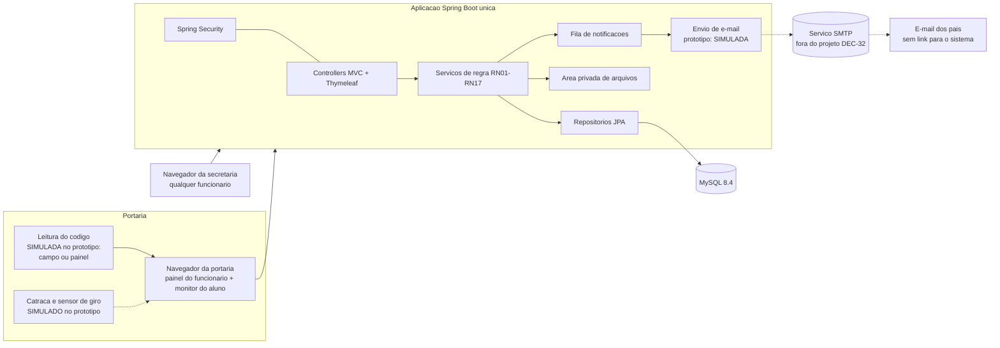
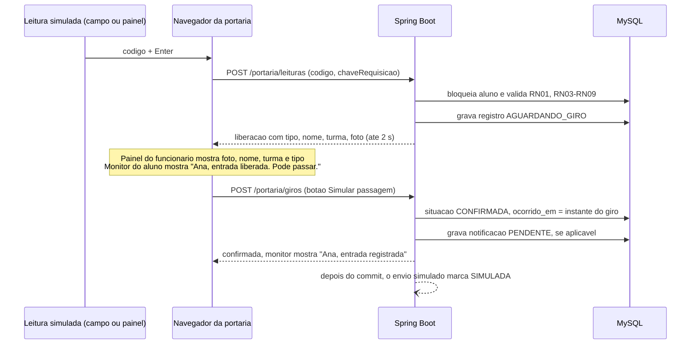
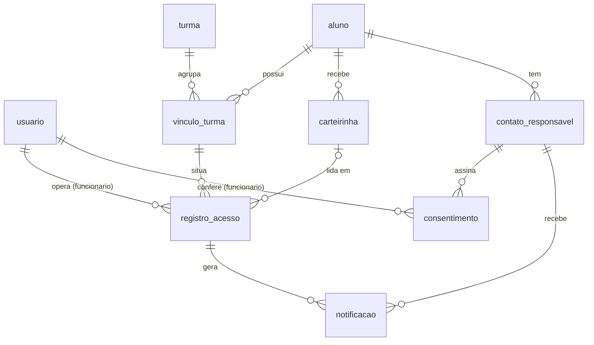

# Arquitetura e dados

**Documentação:** Revisada em 21/10/2026 (DEC-37 a DEC-39) · **Implementação:**
Planejada (nenhum código foi escrito; DDL validado na T-03) · **Atualizado em:** 27/10/2026

A base é a arquitetura da Atividade 13 (A13 p.2–6) e o modelo relacional da
Atividade 14 (A14 p.2–8). Sobre essa base entram as decisões ATU-05 a ATU-07,
DEC-14, DEC-17 a DEC-20 e DEC-37 a DEC-39 (perfil único `FUNCIONARIO`, pais sem
conta). A arquitetura é **proposta para implementação**: o desenvolvimento ainda não
começou (A13 p.2).

## 1. Tecnologias e versões

| Camada | Tecnologia | Versão | Origem | Estado |
|---|---|---|---|---|
| Linguagem | Java | **21 (LTS)** | DEC-17 | Planejada |
| Framework | Spring Boot | **4.1.x** (o patch é fixado no `pom.xml` na criação do projeto) | DEC-17 | Planejada |
| Banco de dados | MySQL | **8.4 (LTS)** | DEC-17; A14 p.9 | Planejada |
| Interface | Thymeleaf, HTML, CSS, JavaScript | Gerenciada pelo Spring Boot | ATU-06; A13 p.3 | Planejada |
| Autenticação e autorização | Spring Security | Gerenciada pelo Spring Boot | ATU-06; A13 p.3 | Planejada |
| E-mail | Spring Mail (SMTP) | Gerenciada pelo Spring Boot | ATU-03, ATU-06; A13 p.3 | Envio **sempre simulado** (DEC-32). O Spring Mail fica só como ponto de extensão |
| Persistência | Spring Data JPA e Bean Validation | Gerenciada pelo Spring Boot | DEC-28 (G1) | Planejada |
| Migrações do banco | Flyway | Gerenciada pelo Spring Boot | DEC-28 (G1) | Planejada |
| Geração de QR Code | ZXing | Versão estável mais recente no Maven Central | DEC-28 (G1); DEC-07 | Planejada |
| Build e testes | Maven, JUnit, Spring Boot Test | Gerenciada pelo Spring Boot | ATU-07; A13 p.6 | Planejada |
| Versionamento | GitHub e GitHub Desktop | — | ATU-07; A13 p.6 | Repositório criado: `https://github.com/LuisEduardo77/PI---Furin.git` (DEC-24) |
| Integração contínua | GitHub Actions | — | ATU-07; A13 p.5–6 | **Não configurada** (A13 p.6) |
| Análise estática | SonarCloud (SonarQube Cloud) | — | ATU-07; A13 p.6 | **Não configurada** |
| Gestão de tarefas | Trello | — | A13 p.6 | Cartões em [`plano-de-implementacao.md`](plano-de-implementacao.md) |
| Apoio à geração de código | Claude, com revisão do grupo | — | A13 p.6; A10 §8.28 | Previsto |

O Spring Boot 4.1 aceita Java de 17 a 26, então o Java 21 está dentro da faixa. Gere
as dependências pelo **Spring Initializr** para Boot 4.1 e não fixe à mão as versões
que o Boot já gerencia.

## 2. Componentes



| Elemento | Função | Fonte | Estado no protótipo |
|---|---|---|---|
| Navegadores | Só os funcionários (ATE e Gestão Escolar, perfil `FUNCIONARIO`) usam o sistema, com acesso completo. Alunos e pais não têm conta | A13 p.3; DEC-37 | Implementado |
| Leitor USB | Lê o QR Code e digita o código no campo de leitura da portaria, seguido de Enter | A13 p.3; RNF07 | **Simulado** (DEC-25): digitação ou colagem no campo, ou botão do painel "Simular leitura (protótipo)". Não há leitor físico |
| Catraca e sensor de giro | Confirmam a passagem | DEC-18 | **Simulados** por botão |
| Interface web | Login, cadastro, portaria, presentes, histórico e contas da equipe | A13 p.3 | Implementado |
| Backend | Valida, aplica as regras, grava e prepara as notificações. O navegador nunca acessa o banco direto | A13 p.3 | Implementado |
| Spring Security | Autenticação e permissões no servidor: toda rota exige funcionário autenticado e ativo | A13 p.3; A10 §5.15; DEC-37 | Implementado |
| MySQL | Dados estruturados e relacionamentos (seção 5) | A13 p.3; A14 | Implementado |
| Área privada de arquivos | Fotos e termos digitalizados. O banco guarda só a referência | A13 p.3; DEC-08 | Implementado |
| Notificações e serviço SMTP | Aviso depois da confirmação, enviado fora do caminho crítico | A13 p.3–5 | **Simulado** (status `SIMULADA`) |

Decisões de infraestrutura (A13 p.4):

- No protótipo, a aplicação, o banco e os arquivos rodam no **mesmo computador**.
- **Hospedagem (DEC-31):** a aplicação roda **local**. O GitHub Pages serve só páginas
  estáticas (HTML, CSS e JavaScript) e não executa Java, Spring Boot nem MySQL. Por isso
  ele pode publicar, de forma opcional, a **documentação** do projeto, mas não a
  aplicação.
- **E-mail (DEC-32):** sempre simulado. Não há provedor SMTP. Não existe mensagem de
  WhatsApp, nem simulada (DEC-37).
- O GitHub hospeda o código e a CI. **Não** é servidor da aplicação nem do banco.

## 3. Fluxos principais

### 3.1 Leitura, liberação e giro (RF09, RF13–RF15, RF22)



**Detalhes de implementação (DEC-28, G2)**

- **Expiração:** uma tarefa agendada (`@Scheduled`) cancela com `SEM_GIRO` as
  liberações que passaram do prazo. O prazo é de **15 s** (DEC-28, A1). A mesma
  verificação roda antes de cada operação da portaria.
- **Janela de 2 s (RN03):** fica no banco, não na memória.
  - A leitura é ignorada quando já existe um registro da mesma carteirinha com
    `lancado_em` nos últimos 2 s e situação diferente de `CONFIRMADA`.
  - Um registro confirmado significa que houve giro, e isso encerra a janela.
- **Leitura simulada (DEC-25):** no perfil `prototipo`, a página `/portaria` inclui o
  painel "Simular leitura (protótipo)", com as carteirinhas fictícias ativas. Cada
  botão chama a mesma função JavaScript do campo de leitura, que faz o
  `POST /portaria/leituras`. Fora do perfil `prototipo`, o painel não é renderizado.
- **Monitor separado (evolução fora do MVP):** a página `/portaria/monitor` é
  atualizada por Server-Sent Events. No protótipo, o monitor é um painel na mesma
  página [DEC-06].

### 3.2 Registro manual (RF11, RF12)

1. O funcionário busca o aluno.
2. O sistema calcula o tipo (RN01).
3. O funcionário informa o horário real e o motivo.
4. O sistema mostra a confirmação e o funcionário confirma.
5. O registro é gravado como `MANUAL` e `CONFIRMADA`, com `ocorrido_em` (horário
   informado) e `lancado_em` (horário do servidor) [DEC-20].
6. A notificação é criada conforme a RN11.

### 3.3 Notificação (RF21)

1. A notificação é criada na mesma transação da confirmação, com status `PENDENTE`.
2. Depois do commit, um processo assíncrono faz o envio:
   - perfil `prototipo` → `SIMULADA`;
   - envio real (`ENVIADA` ou `FALHA`, até **3** tentativas): **fora do projeto**
     (DEC-32). O serviço de envio fica atrás de uma interface, para uma evolução futura.
3. Uma falha não altera a movimentação (A10 §8.26; A13 p.5).
4. O e-mail não tem link para o sistema. Os pais pedem à escola para deixar de receber,
   e um funcionário muda a opção na edição do aluno (RF08, DEC-38).

### 3.4 Consulta do responsável (RF24) *(fora do escopo)*

Saiu com a DEC-37: os pais/responsáveis não têm conta. Não criar pacote, rota, tela
nem tabela para isso.

## 4. Organização do código e configuração (DEC-28, G2)

```
furin-access/
├── README.md
├── docs/  ·  requirements/          # esta documentação
├── pom.xml
├── scripts/                       # backup.ps1, backup.sh (DEC-30)
├── .github/workflows/ci.yml
└── src/
    ├── main/java/br/com/furin/access/
    │   ├── config/        # segurança, perfis, propriedades furin.*
    │   ├── autenticacao/  # RF01–RF03, troca de senha, RN14
    │   ├── aluno/         # RF04–RF08: aluno, turma, vínculo, contato, consentimento
    │   ├── carteirinha/   # RF06, RF07, RN15
    │   ├── portaria/      # RF09–RF15, RF22, RF23, RN01–RN09
    │   ├── presenca/      # RF16, RN12
    │   ├── historico/     # RF18–RF20
    │   ├── notificacao/   # RF21, RN11
    │   ├── conta/         # RF26 (contas da equipe)
    │   ├── arquivo/       # área privada (DEC-08)
    │   └── auditoria/     # log de eventos (A10 §8.15)
    ├── main/resources/
    │   ├── application.yml, application-prototipo.yml
    │   ├── db/migration/  # V1__esquema_inicial.sql, V2__carga_ficticia.sql
    │   ├── templates/     # Thymeleaf
    │   └── static/        # css, js
    └── test/java/...
```

### Perfis de execução

| Perfil | Uso |
|---|---|
| `prototipo` (padrão) | Notificação `SIMULADA`, painel "Simular leitura", botão "Simular passagem", carga fictícia, HTTP local. Sem WhatsApp (DEC-37) |
| `smtp` | **Fora do projeto** (DEC-32). Não é criado no MVP |
| `test` | Testes automatizados |

### Parâmetros

Todo parâmetro fica configurável e nunca escrito direto no código. Os valores abaixo
foram definidos pelo grupo (DEC-28 e anteriores). Os nomes das propriedades são
sugestões [PROP] e podem ser ajustados na implementação, mantendo esta tabela
atualizada.

| Propriedade | Valor | Fonte |
|---|---|---|
| `furin.escola.nome` | Texto do cabeçalho do relatório. **No repositório, só valor fictício** (por exemplo, "Escola Exemplo"). O valor da implantação é configurado no ambiente, fora do repositório | RF20; A10 §8.33 |
| `furin.portaria.janela-repeticao` | 2 s | DEC-02 |
| `furin.portaria.tempo-resposta-max` | 2 s (meta de desempenho) | A08 RNF02 |
| `furin.portaria.prazo-giro` | 15 s | PEND-01 → DEC-28 (A1) |
| `furin.portaria.monitor-exibicao` | 4 s | PEND-12 → DEC-28 (A6) |
| `furin.portaria.painel-limpeza` | 60 s sem leitura | RF10; DEC-28 (A7) |
| `furin.carteirinha.tentativas-colisao` | 3 | RF06; DEC-28 (D7) |
| `furin.presentes.intervalo-atualizacao` | 30 s | RF16; DEC-28 (C2) |
| `furin.busca.max-resultados`, `furin.busca.tamanho-minimo-nome` | 20; 2 caracteres | RF11; DEC-28 (C4) |
| `furin.historico.tamanho-pagina`, `furin.historico.periodo-max-dias` | 50; 31 dias | RF18; DEC-28 (C5) |
| `furin.relatorio.max-registros` | 1.000 | RF20; DEC-28 (C6) |
| `furin.senha.validade-temporaria` | 72 h | DEC-21 |
| `furin.senha.tamanho-temporaria`, `furin.senha.tamanho-minimo` | 12; 8 | PEND-11 → DEC-28 (E4) |
| `furin.login.max-tentativas`, `furin.login.bloqueio` | 5; 15 min | PEND-04 → DEC-28 (E2) |
| `furin.sessao.inatividade` | 30 min | PEND-04 → DEC-28 (E2) |
| `furin.sessao.aviso-antes` | 60 s (mínimo de A11: 20 s) | A11 §5.16.2; DEC-28 (E2) |
| `furin.notificacao.max-tentativas` | 3 | PEND-13 → DEC-28 (F1) |
| `furin.termo.versao-atual` | `v1-2026` | RF05; DEC-26 |
| `furin.arquivos.diretorio` | caminho fora do projeto e fora de `static/` | DEC-08 |
| `furin.arquivos.foto.tipos`, `furin.arquivos.foto.tamanho-max` | JPEG, PNG; 2 MB | PEND-05 → DEC-28 (D1) |
| `furin.arquivos.termo.tipos`, `furin.arquivos.termo.tamanho-max` | PDF, JPEG, PNG; 5 MB | PEND-05 → DEC-28 (D2) |
| `furin.retencao.anos` | 5 (o descarte automático fica fora do MVP) | PEND-16 → DEC-36 |

Ficam **fora** da tabela os segredos, que vêm de variáveis de ambiente: senhas iniciais
da carga, credenciais do banco, token do SonarCloud (seção 6).

### Rotas principais

| Rota | Perfil | RF |
|---|---|---|
| `GET/POST /login`, `POST /logout` | público / autenticado | RF01–RF03 |
| `GET/POST /senha/definir` | FUNCIONARIO | RF01, RN14 |
| `GET/POST /senha/alterar` | FUNCIONARIO | RF01 (fluxo A3) |
| `GET /portaria` | FUNCIONARIO | RF09–RF16, RF22, RF23 |
| `POST /portaria/leituras` | FUNCIONARIO | RF09, RF13–RF15 |
| `POST /portaria/giros` (só no perfil `prototipo`) | FUNCIONARIO | RF09, RF14 |
| `POST /portaria/liberacoes/{id}/cancelar` | FUNCIONARIO | RN02 (DEC-28, A2) |
| `GET/POST /portaria/manual` | FUNCIONARIO | RF11, RF12 |
| `GET/POST /alunos`, `/alunos/{id}/editar` (inclui o aviso por e-mail, DEC-38) | FUNCIONARIO | RF04–RF06, RF08 |
| `POST /alunos/{id}/carteirinhas`, `GET /carteirinhas/{id}/imprimir` | FUNCIONARIO | RF07 |
| `POST /alunos/{id}/consentimentos/{idConsentimento}/revogacao` | FUNCIONARIO | RF05 (DEC-34) |
| `GET /arquivos/{chave}` | FUNCIONARIO | DEC-08 |
| `GET /presentes` | FUNCIONARIO | RF16 |
| `GET /historico` | FUNCIONARIO | RF18–RF20 |
| `/contas/equipe/**` | FUNCIONARIO | RF26 (DEC-39) |

Não existem as rotas `/responsavel/**` nem `/contas/responsaveis/**` (RF24 e RF25 fora
do escopo, DEC-37). Sem login, toda rota (menos `/login`) leva à tela de login.
Qualquer rota não listada é **negada por padrão** (A10 §5.15).

## 5. Modelo de dados

### 5.1 Convenções [DOC A14]

- Modelo relacional em MySQL [ATU-05].
- PKs `BIGINT UNSIGNED AUTO_INCREMENT`.
- Datas em `DATETIME(6)`, gravadas em UTC e exibidas no fuso America/Sao_Paulo.
- `BOOLEAN` com `CHECK` em 0 ou 1.
- Textos obrigatórios não podem ser vazios.
- Totais de presença e primeiro nome são calculados, nunca gravados.
- Nada é apagado fisicamente: a inativação preserva o histórico.

### 5.2 Ajuste mínimo aprovado [DEC-14]

| Tabela | Alteração em relação à A14 | Origem | Situação |
|---|---|---|---|
| `usuario` | `perfil` passa a aceitar só `FUNCIONARIO` (VARCHAR(15)). A A14 previa `ATE` e `GESTAO` | DEC-37 (substitui ATU-04, DEC-10) | Aprovada |
| `usuario` | `login` fica com VARCHAR(80), como na A14. O aumento para 254 servia ao login por e-mail dos responsáveis | DEC-37 (substitui DEC-28, E3) | Aprovada |
| `usuario` | Novos campos `troca_senha_obrigatoria` e `senha_temporaria_expira_em` | DEC-21 | Aprovada |
| `aluno` | `foto_chave` passa a NOT NULL (A14 dizia "opcional, confirmar") | DEC-05 | Aprovada |
| `contato_responsavel` | Novos campos `principal`, `recebe_notificacao` (padrão 1) e a coluna gerada `principal_aluno` (UNIQUE). Os campos de conta e vínculo (`id_usuario`, `vinculo_confirmado_em`, `id_usuario_confirmador`) **saíram** | DEC-09, DEC-22, DEC-37, DEC-38 | Aprovada. A técnica da coluna gerada foi aprovada na T-00 (DEC-28, G2) |
| `contato_responsavel` | Volta a valer "Não cria acesso ao sistema", como na A14 | DEC-37 | Aprovada |
| `registro_acesso` | `tipo` deixa de ser "escolhido na interface" e passa a ser **definido pelo servidor** | ATU-01, DEC-01 | Aprovada |
| `registro_acesso` | `MANUAL` passa a valer para `ENTRADA` e `SAIDA` | DEC-03 | Aprovada |
| `registro_acesso` | Novos campos `situacao`, `lancado_em`, `cancelado_em`, `motivo_cancelamento` e a coluna gerada `pendente_vinculo` (UNIQUE). `ocorrido_em` passa a ser condicional | DEC-19, DEC-20 | Aprovada. Cancelamento pelo funcionário aprovado na T-00 (DEC-28, A2), com o valor `FUNCIONARIO` (DEC-37) |
| `notificacao` | **Nova tabela** | ATU-02, ATU-03 | Aprovada |
| `turma`, `vinculo_turma`, `carteirinha`, `consentimento` | Sem alteração | A14 p.5–7 | — |

**Alternativa não adotada:** criar uma entidade `pessoa_responsavel` com associação N:N
com os alunos (A14 p.4). O grupo escolheu o ajuste mínimo. Irmãos têm um contato
cada um, com os mesmos dados do responsável.

### 5.3 Diagrama



### 5.4 Dicionário das tabelas alteradas e da tabela nova

As tabelas sem alteração (`turma`, `vinculo_turma`, `carteirinha`, `consentimento`)
seguem o dicionário de A14 p.5–7. Elas também estão no DDL da seção 5.5.

**`usuario`**: contas individuais dos funcionários (ATE e Gestão Escolar), todas com o
perfil `FUNCIONARIO` (DEC-37).

| Atributo | Tipo | Obrig. | Observações |
|---|---|---|---|
| id_usuario | BIGINT UNSIGNED | Sim | PK |
| nome | VARCHAR(150) | Sim | — |
| login | VARCHAR(80) | Sim | UK. Normalizado (sem espaços nas pontas, em minúsculas) |
| senha_hash | VARCHAR(255) | Sim | Hash com salt (RNF03) |
| perfil | VARCHAR(15) | Sim | Sempre `FUNCIONARIO` (DEC-37). A coluna fica para uma evolução futura |
| ativo | BOOLEAN | Sim | Padrão 1. Conta inativa não autentica |
| troca_senha_obrigatoria | BOOLEAN | Sim | Padrão 0 |
| senha_temporaria_expira_em | DATETIME(6) | Não | Momento da emissão + 72 h. Só existe com `troca_senha_obrigatoria = 1` |
| criado_em | DATETIME(6) | Sim | Atribuído pelo servidor |

**`aluno`**: alteração.

| Atributo | Tipo | Obrig. | Observações |
|---|---|---|---|
| foto_chave | VARCHAR(255) | **Sim** | Chave do arquivo na área privada. Não é uma URL pública |

**`contato_responsavel`**

| Atributo | Tipo | Obrig. | Observações |
|---|---|---|---|
| id_contato | BIGINT UNSIGNED | Sim | PK |
| id_aluno | BIGINT UNSIGNED | Sim | FK `aluno` |
| nome | VARCHAR(150) | Sim | — |
| telefone | VARCHAR(25) | Cond. | Obrigatório no contato principal (para a escola entrar em contato, fora do sistema) |
| email | VARCHAR(254) | Cond. | Obrigatório no contato principal (notificação) |
| ativo | BOOLEAN | Sim | Padrão 1 |
| principal | BOOLEAN | Sim | Padrão 0. Um contato principal ativo por aluno |
| recebe_notificacao | BOOLEAN | Sim | Padrão **1**. Um funcionário altera a pedido do responsável (DEC-38) |
| principal_aluno | gerada | — | `id_aluno` se `principal = 1 AND ativo = 1`. UNIQUE |

**`registro_acesso`**

| Atributo | Tipo | Obrig. | Observações |
|---|---|---|---|
| id_registro | BIGINT UNSIGNED | Sim | PK |
| id_vinculo | BIGINT UNSIGNED | Sim | FK. Define o aluno e a turma no evento |
| id_usuario | BIGINT UNSIGNED | Sim | FK. Funcionário autenticado |
| id_carteirinha | BIGINT UNSIGNED | Cond. | Obrigatório em LEITURA. NULL em MANUAL |
| tipo | VARCHAR(7) | Sim | `ENTRADA` ou `SAIDA`, definido pelo servidor |
| forma | VARCHAR(7) | Sim | `LEITURA` ou `MANUAL` |
| situacao | VARCHAR(15) | Sim | `AGUARDANDO_GIRO`, `CONFIRMADA` ou `CANCELADA` |
| lancado_em | DATETIME(6) | Sim | Momento em que o servidor recebeu a operação |
| ocorrido_em | DATETIME(6) | Cond. | Só em `CONFIRMADA`. LEITURA = instante do giro. MANUAL = horário informado |
| cancelado_em | DATETIME(6) | Cond. | Só em `CANCELADA` |
| motivo_cancelamento | VARCHAR(15) | Cond. | `SEM_GIRO` ou `FUNCIONARIO` (PEND-03, DEC-37) |
| chave_requisicao | CHAR(36) | Sim | UK. UUID da operação |
| motivo_manual | VARCHAR(200) | Cond. | Obrigatório em MANUAL |
| pendente_vinculo | gerada | — | `id_vinculo` se `AGUARDANDO_GIRO`. UNIQUE |

As telas comuns usam **somente** `situacao = 'CONFIRMADA'`. Os registros cancelados
ficam guardados para rastreabilidade (A10 §8.15).

**`notificacao`**: tabela nova.

| Atributo | Tipo | Obrig. | Observações |
|---|---|---|---|
| id_notificacao | BIGINT UNSIGNED | Sim | PK |
| id_registro | BIGINT UNSIGNED | Sim | FK `registro_acesso` (só confirmadas, conferido pela aplicação) |
| id_contato | BIGINT UNSIGNED | Sim | FK `contato_responsavel` |
| canal | VARCHAR(10) | Sim | `EMAIL` |
| status | VARCHAR(10) | Sim | `PENDENTE`, `ENVIADA`, `FALHA` ou `SIMULADA` |
| tentativas | TINYINT UNSIGNED | Sim | Padrão 0 |
| criado_em | DATETIME(6) | Sim | — |
| ultima_tentativa_em | DATETIME(6) | Não | — |

UNIQUE(`id_registro`, `id_contato`). O corpo do e-mail **não** é guardado, por
minimização (A10 §5.34).

### 5.5 DDL de referência (DEC-28, G2)

> **Estado:** **validado na T-03, em 27/10/2026**, no MySQL 8.4.13: as 9 tabelas foram
> criadas sem erro, e os CHECKs, UNIQUEs e FKs passaram em 86 de 86 casos de teste, sem
> nenhuma alteração neste DDL. Scripts e saída em
> [`evidencias/t-03/`](evidencias/t-03/README.md). Se o DDL mudar, rode os scripts de novo.

```sql
CREATE TABLE usuario (
  id_usuario                  BIGINT UNSIGNED NOT NULL AUTO_INCREMENT,
  nome                        VARCHAR(150)    NOT NULL,
  login                       VARCHAR(80)     NOT NULL,
  senha_hash                  VARCHAR(255)    NOT NULL,
  perfil                      VARCHAR(15)     NOT NULL,
  ativo                       BOOLEAN         NOT NULL DEFAULT 1,
  troca_senha_obrigatoria     BOOLEAN         NOT NULL DEFAULT 0,
  senha_temporaria_expira_em  DATETIME(6)     NULL,
  criado_em                   DATETIME(6)     NOT NULL,
  PRIMARY KEY (id_usuario),
  UNIQUE KEY uk_usuario_login (login),
  CONSTRAINT ck_usuario_nome   CHECK (TRIM(nome) <> ''),
  CONSTRAINT ck_usuario_login  CHECK (TRIM(login) <> ''),
  CONSTRAINT ck_usuario_perfil CHECK (perfil IN ('FUNCIONARIO')),
  CONSTRAINT ck_usuario_bools  CHECK (ativo IN (0,1) AND troca_senha_obrigatoria IN (0,1)),
  CONSTRAINT ck_usuario_temp   CHECK (senha_temporaria_expira_em IS NULL OR troca_senha_obrigatoria = 1)
) ENGINE=InnoDB DEFAULT CHARSET=utf8mb4 COLLATE=utf8mb4_0900_ai_ci;

CREATE TABLE turma (
  id_turma    BIGINT UNSIGNED   NOT NULL AUTO_INCREMENT,
  nome        VARCHAR(30)       NOT NULL,
  ano_letivo  SMALLINT UNSIGNED NOT NULL,
  turno       VARCHAR(10)       NOT NULL,
  ativa       BOOLEAN           NOT NULL DEFAULT 1,
  PRIMARY KEY (id_turma),
  UNIQUE KEY uk_turma (nome, ano_letivo, turno),
  CONSTRAINT ck_turma_nome  CHECK (TRIM(nome) <> ''),
  CONSTRAINT ck_turma_ano   CHECK (ano_letivo BETWEEN 2000 AND 2199),
  CONSTRAINT ck_turma_turno CHECK (turno IN ('MANHA','TARDE','INTEGRAL','NOITE')),
  CONSTRAINT ck_turma_ativa CHECK (ativa IN (0,1))
) ENGINE=InnoDB DEFAULT CHARSET=utf8mb4 COLLATE=utf8mb4_0900_ai_ci;

CREATE TABLE aluno (
  id_aluno    BIGINT UNSIGNED NOT NULL AUTO_INCREMENT,
  matricula   VARCHAR(30)     NOT NULL,
  nome        VARCHAR(150)    NOT NULL,
  foto_chave  VARCHAR(255)    NOT NULL,
  ativo       BOOLEAN         NOT NULL DEFAULT 1,
  criado_em   DATETIME(6)     NOT NULL,
  PRIMARY KEY (id_aluno),
  UNIQUE KEY uk_aluno_matricula (matricula),
  CONSTRAINT ck_aluno_matricula CHECK (TRIM(matricula) <> ''),
  CONSTRAINT ck_aluno_nome      CHECK (TRIM(nome) <> ''),
  CONSTRAINT ck_aluno_foto      CHECK (TRIM(foto_chave) <> ''),
  CONSTRAINT ck_aluno_ativo     CHECK (ativo IN (0,1))
) ENGINE=InnoDB DEFAULT CHARSET=utf8mb4 COLLATE=utf8mb4_0900_ai_ci;

CREATE TABLE vinculo_turma (
  id_vinculo  BIGINT UNSIGNED NOT NULL AUTO_INCREMENT,
  id_aluno    BIGINT UNSIGNED NOT NULL,
  id_turma    BIGINT UNSIGNED NOT NULL,
  inicio_em   DATETIME(6)     NOT NULL,
  fim_em      DATETIME(6)     NULL,
  PRIMARY KEY (id_vinculo),
  UNIQUE KEY uk_vinculo_inicio (id_aluno, inicio_em),
  CONSTRAINT fk_vinculo_aluno FOREIGN KEY (id_aluno) REFERENCES aluno (id_aluno),
  CONSTRAINT fk_vinculo_turma FOREIGN KEY (id_turma) REFERENCES turma (id_turma),
  CONSTRAINT ck_vinculo_periodo CHECK (fim_em IS NULL OR fim_em > inicio_em)
) ENGINE=InnoDB DEFAULT CHARSET=utf8mb4 COLLATE=utf8mb4_0900_ai_ci;

CREATE TABLE carteirinha (
  id_carteirinha  BIGINT UNSIGNED NOT NULL AUTO_INCREMENT,
  id_aluno        BIGINT UNSIGNED NOT NULL,
  codigo          CHAR(32) CHARACTER SET ascii COLLATE ascii_bin NOT NULL,
  emitida_em      DATETIME(6)     NOT NULL,
  expira_em       DATETIME(6)     NULL,
  revogada_em     DATETIME(6)     NULL,
  PRIMARY KEY (id_carteirinha),
  UNIQUE KEY uk_carteirinha_codigo (codigo),
  CONSTRAINT fk_carteirinha_aluno FOREIGN KEY (id_aluno) REFERENCES aluno (id_aluno),
  CONSTRAINT ck_carteirinha_expira CHECK (expira_em IS NULL OR expira_em > emitida_em),
  CONSTRAINT ck_carteirinha_revoga CHECK (revogada_em IS NULL OR revogada_em >= emitida_em)
) ENGINE=InnoDB DEFAULT CHARSET=utf8mb4 COLLATE=utf8mb4_0900_ai_ci;

CREATE TABLE contato_responsavel (
  id_contato              BIGINT UNSIGNED NOT NULL AUTO_INCREMENT,
  id_aluno                BIGINT UNSIGNED NOT NULL,
  nome                    VARCHAR(150)    NOT NULL,
  telefone                VARCHAR(25)     NULL,
  email                   VARCHAR(254)    NULL,
  ativo                   BOOLEAN         NOT NULL DEFAULT 1,
  principal               BOOLEAN         NOT NULL DEFAULT 0,
  recebe_notificacao      BOOLEAN         NOT NULL DEFAULT 1,
  principal_aluno         BIGINT UNSIGNED
      GENERATED ALWAYS AS (CASE WHEN principal = 1 AND ativo = 1 THEN id_aluno END) STORED,
  PRIMARY KEY (id_contato),
  UNIQUE KEY uk_contato_principal (principal_aluno),
  CONSTRAINT fk_contato_aluno     FOREIGN KEY (id_aluno) REFERENCES aluno (id_aluno),
  CONSTRAINT ck_contato_nome      CHECK (TRIM(nome) <> ''),
  CONSTRAINT ck_contato_algum     CHECK (COALESCE(TRIM(telefone),'') <> '' OR COALESCE(TRIM(email),'') <> ''),
  CONSTRAINT ck_contato_principal CHECK (principal = 0
      OR (COALESCE(TRIM(telefone),'') <> '' AND COALESCE(TRIM(email),'') <> '')),
  CONSTRAINT ck_contato_bools     CHECK (ativo IN (0,1) AND principal IN (0,1) AND recebe_notificacao IN (0,1))
) ENGINE=InnoDB DEFAULT CHARSET=utf8mb4 COLLATE=utf8mb4_0900_ai_ci;

CREATE TABLE consentimento (
  id_consentimento       BIGINT UNSIGNED NOT NULL AUTO_INCREMENT,
  id_contato             BIGINT UNSIGNED NOT NULL,
  versao_termo           VARCHAR(30)     NOT NULL,
  assinado_em            DATE            NOT NULL,
  referencia_termo       VARCHAR(255)    NOT NULL,
  id_usuario_conferente  BIGINT UNSIGNED NOT NULL,
  conferido_em           DATETIME(6)     NOT NULL,
  revogado_em            DATETIME(6)     NULL,
  PRIMARY KEY (id_consentimento),
  CONSTRAINT fk_consent_contato    FOREIGN KEY (id_contato) REFERENCES contato_responsavel (id_contato),
  CONSTRAINT fk_consent_conferente FOREIGN KEY (id_usuario_conferente) REFERENCES usuario (id_usuario),
  CONSTRAINT ck_consent_versao CHECK (TRIM(versao_termo) <> ''),
  CONSTRAINT ck_consent_ref    CHECK (TRIM(referencia_termo) <> ''),
  CONSTRAINT ck_consent_revoga CHECK (revogado_em IS NULL OR revogado_em >= conferido_em)
) ENGINE=InnoDB DEFAULT CHARSET=utf8mb4 COLLATE=utf8mb4_0900_ai_ci;

CREATE TABLE registro_acesso (
  id_registro          BIGINT UNSIGNED NOT NULL AUTO_INCREMENT,
  id_vinculo           BIGINT UNSIGNED NOT NULL,
  id_usuario           BIGINT UNSIGNED NOT NULL,
  id_carteirinha       BIGINT UNSIGNED NULL,
  tipo                 VARCHAR(7)      NOT NULL,
  forma                VARCHAR(7)      NOT NULL,
  situacao             VARCHAR(15)     NOT NULL,
  lancado_em           DATETIME(6)     NOT NULL,
  ocorrido_em          DATETIME(6)     NULL,
  cancelado_em         DATETIME(6)     NULL,
  motivo_cancelamento  VARCHAR(15)     NULL,
  chave_requisicao     CHAR(36) CHARACTER SET ascii COLLATE ascii_bin NOT NULL,
  motivo_manual        VARCHAR(200)    NULL,
  pendente_vinculo     BIGINT UNSIGNED
      GENERATED ALWAYS AS (CASE WHEN situacao = 'AGUARDANDO_GIRO' THEN id_vinculo END) STORED,
  PRIMARY KEY (id_registro),
  UNIQUE KEY uk_registro_chave (chave_requisicao),
  UNIQUE KEY uk_registro_pendente (pendente_vinculo),
  KEY ix_registro_vinculo (id_vinculo, situacao, ocorrido_em),
  KEY ix_registro_ocorrido (situacao, ocorrido_em),
  CONSTRAINT fk_registro_vinculo     FOREIGN KEY (id_vinculo) REFERENCES vinculo_turma (id_vinculo),
  CONSTRAINT fk_registro_usuario     FOREIGN KEY (id_usuario) REFERENCES usuario (id_usuario),
  CONSTRAINT fk_registro_carteirinha FOREIGN KEY (id_carteirinha) REFERENCES carteirinha (id_carteirinha),
  CONSTRAINT ck_registro_tipo     CHECK (tipo IN ('ENTRADA','SAIDA')),
  CONSTRAINT ck_registro_forma    CHECK (forma IN ('LEITURA','MANUAL')),
  CONSTRAINT ck_registro_situacao CHECK (situacao IN ('AGUARDANDO_GIRO','CONFIRMADA','CANCELADA')),
  CONSTRAINT ck_registro_leitura  CHECK (forma <> 'LEITURA'
      OR (id_carteirinha IS NOT NULL AND motivo_manual IS NULL)),
  CONSTRAINT ck_registro_manual   CHECK (forma <> 'MANUAL'
      OR (id_carteirinha IS NULL AND COALESCE(TRIM(motivo_manual),'') <> '' AND situacao = 'CONFIRMADA')),
  CONSTRAINT ck_registro_ocorrido CHECK ((situacao = 'CONFIRMADA') = (ocorrido_em IS NOT NULL)),
  CONSTRAINT ck_registro_cancel   CHECK ((situacao = 'CANCELADA') = (cancelado_em IS NOT NULL)
      AND (situacao = 'CANCELADA') = (motivo_cancelamento IS NOT NULL)),
  CONSTRAINT ck_registro_motcanc  CHECK (motivo_cancelamento IS NULL OR motivo_cancelamento IN ('SEM_GIRO','FUNCIONARIO')),
  CONSTRAINT ck_registro_horarios CHECK (ocorrido_em IS NULL
      OR (forma = 'MANUAL'  AND ocorrido_em <= lancado_em)
      OR (forma = 'LEITURA' AND ocorrido_em >= lancado_em))
) ENGINE=InnoDB DEFAULT CHARSET=utf8mb4 COLLATE=utf8mb4_0900_ai_ci;

CREATE TABLE notificacao (
  id_notificacao       BIGINT UNSIGNED  NOT NULL AUTO_INCREMENT,
  id_registro          BIGINT UNSIGNED  NOT NULL,
  id_contato           BIGINT UNSIGNED  NOT NULL,
  canal                VARCHAR(10)      NOT NULL DEFAULT 'EMAIL',
  status               VARCHAR(10)      NOT NULL DEFAULT 'PENDENTE',
  tentativas           TINYINT UNSIGNED NOT NULL DEFAULT 0,
  criado_em            DATETIME(6)      NOT NULL,
  ultima_tentativa_em  DATETIME(6)      NULL,
  PRIMARY KEY (id_notificacao),
  UNIQUE KEY uk_notificacao (id_registro, id_contato),
  KEY ix_notificacao_status (status),
  CONSTRAINT fk_notif_registro FOREIGN KEY (id_registro) REFERENCES registro_acesso (id_registro),
  CONSTRAINT fk_notif_contato  FOREIGN KEY (id_contato) REFERENCES contato_responsavel (id_contato),
  CONSTRAINT ck_notif_canal  CHECK (canal IN ('EMAIL')),
  CONSTRAINT ck_notif_status CHECK (status IN ('PENDENTE','ENVIADA','FALHA','SIMULADA'))
) ENGINE=InnoDB DEFAULT CHARSET=utf8mb4 COLLATE=utf8mb4_0900_ai_ci;
```

**Observações**

- O MySQL proíbe `ON DELETE`/`ON UPDATE` com ação nas colunas usadas em CHECK ou em
  colunas geradas. Por isso as FKs mantêm o comportamento padrão.
- Algumas regras envolvem várias tabelas e ficam nos serviços, dentro de transações:
  - cadastro completo (RN16);
  - uma carteirinha válida por aluno (RN15);
  - um vínculo de turma aberto por aluno;
  - sequência de movimentações (RN01);
  - uma liberação por vez no ponto de leitura (RN05).

### 5.6 Carga fictícia do protótipo (DEC-28, G2)

As senhas iniciais vêm de variáveis de ambiente e **nunca** ficam no repositório
(A10 §5.17, §8.33).

| Login | Nome | Perfil |
|---|---|---|
| `ate.demo` | ATE Demo | FUNCIONARIO |
| `gestao.demo` | Gestão Demo | FUNCIONARIO |

Os pais/responsáveis entram **só como contatos**, sem conta (DEC-37):

| Contato principal | Alunos | Aviso por e-mail |
|---|---|---|
| Carla Teste (`carla.teste@example.com`) | Ana Teste (6A, 000123) e Davi Teste (3B, 000124), que são irmãos (um contato para cada aluno) | Ligado |
| Bruno Exemplo (`bruno.pai@example.com`) | Bia Exemplo (6A, 000200) | Desligado |

**Turmas:** nenhum RF cria ou edita turmas (PEND-14, DEC-28, D3). A carga fictícia
cria as turmas usadas nos exemplos (por exemplo, 3B e 6A, turno MANHA, ano letivo
2026).

**Consentimentos fictícios:** versão `v1-2026` (DEC-26), referência "Protocolo
fictício 0001" e assim por diante.

**Fotos e termos fictícios:** a carga usa imagens geradas (silhueta ou iniciais) e um
termo de exemplo em PDF, nunca fotos ou documentos de pessoas reais (A10 §8.33).

**Medição de desempenho:** a carga de 800 alunos e 30 dias de movimentações usada no
RNF02 é gerada por script separado, só para o teste, e não entra na carga padrão
(DEC-28, G4).

## 6. Segurança e acessibilidade na arquitetura

| Tema | Decisão de arquitetura | Fonte |
|---|---|---|
| Permissões | Negar por padrão. Conferir no servidor, em toda requisição, se há funcionário autenticado e ativo | A10 §5.15, §5.34; DEC-37 |
| Senhas | `PasswordEncoder` delegante do Spring Security (bcrypt por padrão) | A10 §5.17; RNF03 |
| Sessão | Formulário de login, nova sessão a cada login, cookie `HttpOnly`/`SameSite=Lax` (e `Secure` com HTTPS), CSRF ligado | A10 §8.5, §8.28 |
| Entrada e saída de dados | Bean Validation no servidor, JPA parametrizado, `th:text` (nunca `th:utext` com dado do usuário) | A10 §8.28 |
| Segredos | Variáveis de ambiente ou `application-local.yml` no `.gitignore`. Na CI, *Secrets* | A10 §5.17; A13 p.6 |
| Logs | Logger de auditoria separado. Sem senhas, sem documentos, e-mail mascarado | A10 §8.15 |
| Arquivos | Diretório privado fora de `static/`, nome em UUID, entrega por controller autorizado | A10 §5.34; DEC-08 |
| HTTPS e TLS | **Planejados.** A demonstração local usa HTTP | RNF04; A10 §8.24 |
| Backup | Script simples (seção 6.1) | A10 §8.13; LGPD art. 46; DEC-30 |
| Retenção e descarte | 5 anos após o fim do tratamento (DEC-33, DEC-36, [RNF05](../requirements/rnf/RNF05.md)). Nada é apagado fisicamente no MVP (seção 5.1) | RNF05; LGPD art. 15, 16 |
| Acessibilidade | Layout-base com `lang="pt-BR"`, link "Ir para o conteúdo principal", foco visível de 3 px, paleta de A11, regiões `role="status"`/`role="alert"` na portaria | A11; RNF06 |

### 6.1 Backup do protótipo (DEC-30)

**Por que existe:** a LGPD exige medidas contra a perda e a destruição acidental dos
dados (art. 46), e o grupo adotou o controle de backup da ISO/IEC 27002 §8.13 (A10).
A lei não cita "backup" com essa palavra, mas a cópia de segurança é a forma mais
simples de atender a essa exigência.

| Item | Como fica |
|---|---|
| O que copiar | O banco (`mysqldump` do esquema `furin`) e a pasta privada de fotos e termos (`furin.arquivos.diretorio`) |
| Como | Um script em `scripts/`: `backup.ps1` (Windows) e `backup.sh` (Linux/macOS). O script gera uma pasta com data e hora, com o `.sql` e um `.zip` dos arquivos |
| Quando | No protótipo, antes de cada demonstração e no fim de cada dia de testes. Na implantação, todo dia, pelo Agendador de Tarefas ou pelo `cron` |
| Onde guardar | Pasta **fora do projeto**, indicada pela variável `FURIN_BACKUP_DIR`. **Nunca** no Git (a pasta entra no `.gitignore`). Na implantação, uma cópia também fora do computador do servidor |
| Quantas cópias | As **7 últimas**. O script apaga as mais antigas |
| Teste de restauração | Restaurar uma vez em um banco vazio e conferir os dados. A evidência vai para o cartão do Trello (T-47) |
| Segurança | O usuário do banco no script tem só permissão de leitura. A senha vem de variável de ambiente. Na implantação, o `.zip` é protegido por senha, porque o backup contém dados pessoais |

## 7. Qualidade e integração contínua

**Estado: planejada, não configurada.** Fica proporcional ao PI (ATU-07; A13 p.5–6).

- **Fluxo:**
  - um cartão do Trello vira uma branch;
  - commit e push pelo GitHub Desktop;
  - pull request revisado por outro integrante antes de entrar na `main`.
- **Pipeline:** compila, roda os testes e faz a análise estática. **Não publica** a
  aplicação.
- **SonarCloud:** recebe só o código-fonte, nunca o banco nem dados de alunos. O token
  fica em *Secrets*.

Configuração aprovada como ponto de partida (DEC-28, G2):

```yaml
# .github/workflows/ci.yml
name: CI
on:
  push: { branches: [main] }
  pull_request:
jobs:
  build:
    runs-on: ubuntu-latest
    env:
      SONAR_TOKEN: ${{ secrets.SONAR_TOKEN }}
    services:
      mysql:
        image: mysql:8.4
        env:
          MYSQL_DATABASE: furin_test
          MYSQL_USER: furin
          MYSQL_PASSWORD: furin_test_only   # credencial descartável, exclusiva da CI
          MYSQL_RANDOM_ROOT_PASSWORD: "yes"
        ports: ["3306:3306"]
        options: >-
          --health-cmd="mysqladmin ping -h 127.0.0.1" --health-interval=5s --health-retries=20
    steps:
      - uses: actions/checkout@v4
        with: { fetch-depth: 0 }
      - uses: actions/setup-java@v4
        with: { distribution: temurin, java-version: '21', cache: maven }
      - name: Build e testes
        run: mvn -B verify -Dspring.profiles.active=test
        env:
          SPRING_DATASOURCE_URL: jdbc:mysql://127.0.0.1:3306/furin_test
          SPRING_DATASOURCE_USERNAME: furin
          SPRING_DATASOURCE_PASSWORD: furin_test_only
      - name: Análise SonarCloud
        if: env.SONAR_TOKEN != ''
        run: >-
          mvn -B org.sonarsource.scanner.maven:sonar-maven-plugin:sonar
          -Dsonar.projectKey=${{ vars.SONAR_PROJECT_KEY }}
          -Dsonar.organization=${{ vars.SONAR_ORG }}
          -Dsonar.host.url=https://sonarcloud.io
```

## 8. Histórico deste arquivo

| Data | Alteração |
|---|---|
| 19/10/2026 | Primeira versão (lote 2) |
| 19/10/2026 | Revisão final (lote 15): novos parâmetros vindos dos RF (nome da escola, painel, busca, histórico, relatório, versão e tamanho do termo), turmas pela carga inicial (PEND-14), retenção (PEND-16) |
| 19/10/2026 | Revisão T-00: parâmetros com os valores aprovados (DEC-28), repositório (DEC-24), leitura simulada pelo painel (DEC-25), versão do termo (DEC-26) e rota de revogação (DEC-29) |
| 19/10/2026 | Decisões complementares: backup simples (DEC-30, seção 6.1), aplicação local e GitHub Pages só para a documentação (DEC-31), e-mail e WhatsApp sempre simulados (DEC-32), guarda pela LGPD (DEC-33) e revogação do termo (DEC-34) |
| 19/10/2026 | Parâmetro `furin.retencao.anos` = 5 (DEC-36) |
| 21/10/2026 | Perfil único `FUNCIONARIO` (DEC-37 a DEC-39): DDL de `usuario` e `contato_responsavel` sem conta de responsável, `motivo_cancelamento` com `FUNCIONARIO` (VARCHAR(15)), rotas `/responsavel/**` e `/contas/responsaveis/**` removidas, `/contas/gestao/**` → `/contas/equipe/**`, carga sem contas de responsáveis, §3.4 fora do escopo |
| 27/10/2026 | T-03: DDL da §5.5 validado no MySQL 8.4.13 sem alteração (9 tabelas, 86 de 86 casos de teste). Aviso de "não executado" substituído pelo estado validado |
