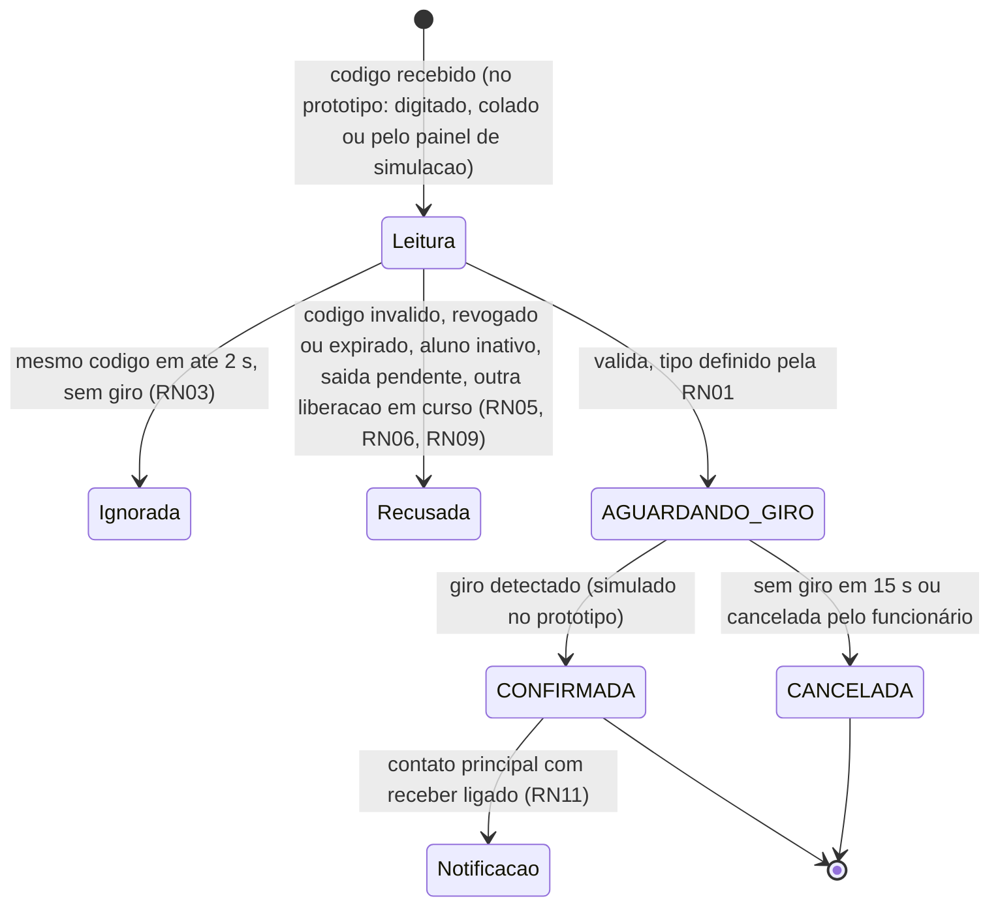

# Regras de negócio

**Documentação:** Revisada em 21/10/2026 (DEC-37 a DEC-39) · **Implementação:** Planejada ·
**Atualizado em:** 21/10/2026

As regras RN01–RN17 organizam o comportamento que os RF exigem. Os IDs RN são novos,
criados nesta consolidação. Os IDs dos RF e RNF originais foram mantidos.

Cada regra tem uma **Situação**:

- **Aprovada:** decidida pelo grupo (DEC/ATU).
- **Documentada:** já consta em uma atividade entregue.
- **Aprovada na T-00:** proposta técnica aprovada na revisão do grupo (DEC-28).

## 1. Medidas e parâmetros

Todos os valores ficam **configuráveis** no código (propriedades `furin.*`, ver
[`arquitetura-e-dados.md`](arquitetura-e-dados.md) §4) e nunca escritos direto nas
regras.

### 1.1 Medidas definidas

| Medida | Valor | Fonte |
|---|---|---|
| Janela anti-repetição do mesmo código | **2 segundos** | DEC-02 |
| Fim antecipado da janela | Imediato, quando há giro do aluno | DEC-02 |
| Resposta da leitura na tela | **até 2 segundos** | A08 RNF02 |
| Resposta da confirmação do giro | **até 2 segundos** | DEC-28 (A10) |
| Prazo para o giro depois da liberação | **15 segundos** | PEND-01 → DEC-28 (A1) |
| Validade da senha temporária | **72 horas** | DEC-21 |
| Troca da senha temporária | Obrigatória no primeiro acesso | DEC-21 |
| Tamanho da senha temporária | **12 caracteres** | PEND-11 → DEC-28 (E4) |
| Tamanho mínimo da nova senha | **8 caracteres**, diferente da temporária | PEND-11 → DEC-28 (E4) |
| Tentativas seguidas de login antes do bloqueio | **5** | PEND-04 → DEC-28 (E2) |
| Duração do bloqueio de login | **15 minutos** | PEND-04 → DEC-28 (E2) |
| Inatividade até a sessão expirar | **30 minutos** | PEND-04 → DEC-28 (E2) |
| Aviso antes de a sessão expirar | **60 segundos** (o mínimo de A11 é 20 s) | A11 §5.16.2; DEC-28 (E2) |
| Motivo do registro manual | Obrigatório, até **200 caracteres** | A14 p.8; DEC-04 |
| Código da carteirinha | **32 caracteres hexadecimais** aleatórios | A14 p.6 |
| Novas tentativas em caso de colisão do código | **3** | DEC-28 (D7) |
| Carteirinhas válidas por aluno | No máximo **1** | A14 p.6 |
| Foto do aluno | **JPEG ou PNG, até 2 MB** | PEND-05 → DEC-28 (D1) |
| Termo digitalizado | **PDF, JPEG ou PNG, até 5 MB** | PEND-05 → DEC-28 (D2) |
| Versão vigente do termo | **`v1-2026`** | DEC-26 |
| Mensagem no monitor do aluno | **4 segundos**, depois volta à espera | PEND-12 → DEC-28 (A6) |
| Painel do funcionário volta ao estado vazio | Na próxima leitura ou depois de **60 s** sem leitura | DEC-28 (A7) |
| Atualização automática da tela Presentes | A cada **30 s**, mais o botão "Atualizar" | DEC-28 (C2) |
| Tentativas de envio de e-mail | **3**, só numa evolução com envio real (no MVP o envio é sempre simulado, DEC-32) | PEND-13 → DEC-28 (F1) |
| Fuso de exibição | America/Sao_Paulo (gravação em UTC) | A14 (convenções) |
| Padrão da preferência de notificação | **Receber** | DEC-22 |

Os limites de busca (20 resultados, 2 caracteres), de histórico (50 por página, 31 dias)
e de impressão (1.000 registros) estão nos RF11, RF18 e RF20 (DEC-28, C4 a C6).

### 1.2 Backup, hospedagem, e-mail e guarda de dados

| Tema | Decisão | Fonte |
|---|---|---|
| Backup | Script simples com o dump do banco e a cópia da pasta de fotos e termos. Feito antes de cada demonstração e no fim de cada dia de testes, guardando as **7 últimas** cópias fora do projeto. Restauração testada uma vez, com evidência | PEND-07 → DEC-30 |
| Hospedagem | A aplicação roda **local** no computador da equipe. O GitHub Pages pode publicar só a documentação | PEND-08 → DEC-31 |
| E-mail | **Sempre simulado.** Nenhuma mensagem real é enviada. Não há mensagem de WhatsApp (DEC-37) | PEND-08 → DEC-32, DEC-37 |
| Guarda e descarte dos dados | Regra da LGPD (art. 15 e 16) com prazo de **5 anos** após o fim do tratamento (saída do aluno ou revogação do termo); depois, eliminar ou anonimizar. No protótipo, nada é descartado automaticamente | PEND-16 → DEC-33, DEC-36 |
| Recusa ou revogação do termo | O aluno **não** fica no sistema. Ele continua estudando, com o controle feito fora do sistema | PEND-15 → DEC-34 |

## 2. Ciclo de uma leitura

Situações de uma leitura:

- **Ignorada:** nada é gravado e o funcionário vê "Leitura já recebida".
- **Recusada:** nada é gravado e o motivo vai para o log.
- **Aguardando giro:** registro gravado com `situacao = AGUARDANDO_GIRO`.
- **Confirmada:** a movimentação entra no histórico, no painel e na consulta do
  responsável.
- **Cancelada:** fica só para rastreabilidade e não aparece nas telas comuns.

## 3. Regras

### RN01: definição automática do tipo
- **Situação:** Aprovada (ATU-01, DEC-01). Linhas 1 e 2 da tabela documentadas em
  A10 §8.26; linha 3 aprovada na T-00 (DEC-28, A5).
- **RF:** RF13, RF09, RF14, RF12.

O servidor olha a **última movimentação confirmada** do aluno, em qualquer data:

| Situação do aluno | Resultado |
|---|---|
| Nenhuma movimentação, ou a última é `SAIDA` | `ENTRADA` |
| A última é `ENTRADA`, no mesmo dia (America/Sao_Paulo) | `SAIDA` |
| A última é `ENTRADA`, em dia anterior | Leitura recusada por saída pendente (RN06) |

- Liberações pendentes ou canceladas não contam.
- O tipo **nunca** vem da interface: se a requisição trouxer um tipo, ele é ignorado.
- O funcionário não escolhe o tipo [ATU-01]. Ele apenas confere o resultado na tela (A13 p.4).

**Verificação:** teste de unidade com a tabela de decisão. Teste de integração enviando
`tipo` na requisição.

### RN02: liberação e confirmação por giro
- **Situação:** Aprovada (DEC-18, DEC-19). Prazo de **15 s** e cancelamento por um funcionário
  aprovados na T-00 (DEC-28, A1 e A2).
- **RF:** RF09, RF14, RF22. **RNF:** RNF02, RNF07.

1. Uma leitura válida grava um registro com `situacao = AGUARDANDO_GIRO`.
2. O servidor responde em até 2 s (RNF02):
   - o painel do funcionário mostra foto, nome, turma e tipo (RF10);
   - o monitor do aluno mostra a liberação (RF22).
3. Quando chega o evento de giro, o registro passa a `CONFIRMADA` e `ocorrido_em`
   recebe o instante do giro.
4. Sem giro dentro de **15 s**, o registro passa a `CANCELADA`,
   com motivo `SEM_GIRO`:
   - o funcionário vê "Liberação expirada — Ana não passou";
   - nada vai para o histórico nem para o painel, e não há notificação.
5. **[DEC-28, A2]** O funcionário pode cancelar uma liberação pendente (motivo `FUNCIONARIO`), por
   exemplo quando o tipo calculado não corresponde ao que está acontecendo. Uma
   movimentação já confirmada **não** é editada.
6. **No protótipo, a leitura e o giro são simulados** (DEC-18, DEC-25). O código chega
   pelo campo de leitura (digitado ou colado) ou pelo painel "Simular leitura", e o
   giro pelo botão "Simular passagem (giro)". Na integração física (fora do MVP), o
   código virá do leitor USB e o giro, do sensor da catraca.

**Verificação:** testes de integração da confirmação e da expiração. Demonstração do
fluxo com o botão de simulação.

### RN03: janela anti-repetição de 2 segundos
- **Situação:** Aprovada (DEC-02). **RF:** RF15.

- Uma leitura do **mesmo código** em até **2 s** depois da última leitura aceita é
  **ignorada**: o funcionário vê "Leitura já recebida" e nada é gravado.
- Se houver **giro** desse aluno, a janela termina **na hora**, e uma nova leitura é
  tratada normalmente.
- A janela é controlada no servidor, não só no navegador.

**Verificação:**
- duas leituras com 0,5 s de intervalo geram uma liberação;
- leitura, giro em 1 s e nova leitura em 1,5 s geram uma nova liberação.

### RN04: leitura repetida com liberação pendente
- **Situação:** Aprovada na T-00 (DEC-28, A4), derivada da DEC-19. **RF:** RF15.

Uma leitura do mesmo código enquanto a liberação dele está `AGUARDANDO_GIRO`, mesmo
depois de 2 s, **não** cria outra liberação. A resposta é "Aguardando passagem" e o
prazo não é renovado.

### RN05: uma liberação por vez no ponto de leitura
- **Situação:** Aprovada na T-00 (PEND-09, DEC-28, A3). **RF:** RF15.

O MVP tem um ponto de leitura. Enquanto houver uma liberação pendente, a leitura de
**outro** aluno é recusada com "Aguarde a passagem do aluno anterior", e nada é gravado.

### RN06: toda entrada exige uma saída
- **Situação:** Aprovada (DEC-04). A recusa da leitura com pendência foi aprovada na
  T-00 (DEC-28, A5).
- **RF:** RF12, RF16.

- Não existe fechamento automático no fim do dia.
- Uma entrada confirmada sem saída continua como **saída pendente** e aparece no painel
  (RF16).
- Se um aluno com saída pendente de um dia anterior ler a carteirinha, a
  leitura é recusada. O funcionário vê "Saída pendente de DD/MM: registre a saída manual antes
  da nova entrada". O aluno vê a mensagem do RF23.
- O funcionário encerra a pendência com uma **saída manual** com motivo (RF12, RN07).

### RN07: registro manual excepcional
- **Situação:** Documentada (A08 RF12; A14 p.8) e ampliada por Aprovação (DEC-03,
  DEC-04, DEC-20). Os itens 1 e 5 foram aprovados na T-00 (DEC-28, B1 e B2).
- **RF:** RF11, RF12, RF19.

O registro manual é uma **exceção** à leitura normal. Exemplos: aluno sem carteirinha,
ou saída não registrada no dia anterior.

1. O funcionário escolhe o aluno pela busca (RF11). O tipo é definido pela RN01, e
   uma saída pendente de dia anterior gera uma `SAIDA`. A confirmação mostra o tipo
   calculado (A11 §5.9.12).
2. **Motivo obrigatório**, com até 200 caracteres. Exemplos fictícios: "Aluno esqueceu a
   carteirinha" e "Saída não registrada no dia anterior".
3. O funcionário informa o **horário real** (`ocorrido_em`). O servidor grava o **horário do
   lançamento** (`lancado_em`) [DEC-20].
4. O horário informado não pode ser posterior ao lançamento nem anterior ou igual à
   última movimentação confirmada do aluno.
5. O registro é gravado direto como `CONFIRMADA`, sem giro, com `forma =
   MANUAL` e sem carteirinha.
6. Se houver uma liberação pendente para o mesmo aluno, o registro manual fica bloqueado
   até ela ser confirmada ou cancelada.

### RN08: concorrência e reenvio
- **Situação:** Documentada (A14 p.8; A13 p.4; A10 §8.26). **RF:** RF15.

- Toda operação sobre o mesmo aluno (leitura, giro, manual) roda numa transação que
  começa bloqueando o aluno (`SELECT … FOR UPDATE`).
- Cada operação leva uma `chave_requisicao` (UUID). Um reenvio com a mesma chave
  devolve o resultado original e **não** cria um registro novo.
- O banco também impede duas liberações pendentes para o mesmo aluno, com uma restrição
  UNIQUE (ver `docs/arquitetura-e-dados.md`).

### RN09: leitura inválida
- **Situação:** Documentada (A14 p.6; A08 RF23; A09 art. 17). **RF:** RF23, RF10.

| Situação | Painel do funcionário | Monitor do aluno |
|---|---|---|
| Código não encontrado | "Código não reconhecido" | Mensagem do RF23 |
| Carteirinha revogada ou expirada | "Carteirinha revogada/expirada. Emitir segunda via" | Mensagem do RF23 |
| Aluno inativo ou sem turma vigente | "Aluno inativo / sem turma vigente" | Mensagem do RF23 |
| Saída pendente de dia anterior | RN06 | Mensagem do RF23 |
| Outra liberação em curso | RN05 | "Aguarde" |

Nenhuma dessas situações grava movimentação. Todas vão para o log (A10 §8.15).

### RN10: dia, fuso e horários
- **Situação:** Documentada (A14, convenções).

Os horários são gravados em UTC (`DATETIME(6)`) e exibidos no fuso America/Sao_Paulo.
"Mesmo dia" (RN01) e "hoje" (RN12) são calculados nesse fuso.

### RN11: notificação ao contato principal
- **Situação:** Aprovada (ATU-02, ATU-03, DEC-09, DEC-22, DEC-37, DEC-38). Os itens 1, 2 e 6 estão
  documentados em A13 p.5 e A10 §8.26. O conteúdo mínimo vem de A10 §5.34. São **3**
  tentativas (DEC-28, F1). A notificação de registros manuais foi aprovada na T-00
  (PEND-10, DEC-28, B3).
- **RF:** RF21.

1. É criada depois de cada movimentação `CONFIRMADA`, na mesma transação, com status
   `PENDENTE`, quando o contato principal está ativo, tem e-mail e está com
   `recebe_notificacao = 1`. Essa opção só é alterada por um funcionário, a pedido do
   responsável (RF08, DEC-38).
2. É enviada **depois do commit**, fora do caminho crítico da leitura:
   - **no protótipo:** o status vira `SIMULADA` e nada é enviado. A tela indica a
     simulação;
   - **envio real:** fora do projeto (DEC-32). O modelo já prevê `ENVIADA` e `FALHA`,
     com até **3** tentativas (DEC-28, F1), para uma evolução futura.
3. O **conteúdo é mínimo**: primeiro nome, tipo, data e hora e forma. Não vão foto,
   turma, matrícula nem link para o sistema (DEC-37). Exemplo fictício:
   > Assunto: Furin Access — entrada registrada
   > Ana entrou na escola em 19/10/2026 às 07:02 (leitura da carteirinha).
   > Em caso de dúvida, procure a secretaria da escola.
4. Os pais/responsáveis **não têm conta** nem tela no sistema (DEC-37). A A13 p.5 previa
   um link com login, que saiu junto com a consulta (RF24).
5. Leituras ignoradas, recusadas ou canceladas **não** geram notificação.
6. Uma falha no envio **nunca** desfaz a movimentação, e as falhas vão para o log.
7. **[DEC-28, B3]** Movimentações manuais também geram notificação, com o texto
   "registro manual" e o horário informado.

### RN12: cálculo de presença
- **Situação:** Documentada (A11 §5.12.12; A13 p.4; A14 p.4). O refinamento sobre
  entradas de dias anteriores foi aprovado na T-00 (DEC-28, C1). **RF:** RF16, RF11.

- Um aluno está **presente** quando a sua última movimentação `CONFIRMADA` é uma
  `ENTRADA`.
- **Refinamento (DEC-28, C1):** como toda entrada exige uma saída (RN06), uma entrada de
  ontem sem saída faria o aluno contar como presente hoje. Para evitar isso:

  | Última movimentação confirmada | Onde aparece | Conta em "Presentes agora"? |
  |---|---|---|
  | `ENTRADA` de **hoje** (America/Sao_Paulo) | "Presentes agora" e "Por turma" | Sim |
  | `ENTRADA` de **dia anterior** | "Saídas pendentes" (RF16) | **Não** |
  | `SAIDA`, ou nenhuma movimentação | Fora da escola | Não |

- Os totais por turma usam o vínculo de turma vigente. Turmas ativas com zero também
  aparecem (DEC-28, C3).
- Os totais são sempre calculados, nunca gravados.
- O painel **não** comprova presença em sala de aula (A13 p.4).
- O total apoia a contagem da merenda (A02). Por isso as saídas pendentes ficam fora
  dele.
- O total considera só os alunos cadastrados no Furin Access. Alunos sem termo
  (DEC-34) são controlados pela escola fora do sistema e precisam ser somados por ela.

**Verificação:** teste de integração com três alunos fictícios: um com entrada de
hoje, um com entrada de 16/10 sem saída e um com entrada e saída hoje. O total deve ser
1 e a lista de pendências deve ter 1.

### RN13: escopo da consulta do responsável *(fora do escopo)*
- **Situação:** **Obsoleta** (DEC-37). Os pais/responsáveis não têm conta, então não há
  consulta (RF24) nem vínculo de conta a conferir. O ID RN13 fica reservado e não é
  reaproveitado.

### RN14: senha temporária
- **Situação:** Aprovada (DEC-21, DEC-28 E4, DEC-39). A geração e o armazenamento estão
  documentados em A10 §5.17. Tamanhos: temporária com **12** caracteres e nova com pelo
  menos **8** (DEC-28, E4). Só existem contas de funcionários (DEC-37).
- **RF:** RF26, RF01.

| Conta | Quem gera a senha | Quem entrega | Situação |
|---|---|---|---|
| Primeiras contas (`ate.demo`, `gestao.demo`) | Carga inicial, com senhas vindas de variáveis de ambiente | Fora do sistema | Aprovada (DEC-13) |
| Novas contas da equipe | Qualquer funcionário (RF26) | Quem gerou, pessoalmente e de forma reservada | Aprovada (DEC-39) |

- É gerada por uma fonte aleatória criptográfica (`SecureRandom`), com **12 caracteres**
  (DEC-28, E4).
- É exibida **uma única vez** ao funcionário que criou a conta ou gerou a nova senha, e
  gravada **só como hash**. Nunca aparece em log.
- Expira em **72 h** e exige troca no primeiro acesso.
- O sistema não envia a senha por nenhum canal (nem e-mail, nem WhatsApp) (DEC-37).
- Se a senha vencer, qualquer funcionário gera uma nova (RF26).

### RN15: carteirinha
- **Situação:** Documentada (A14 p.6). **RF:** RF06, RF07.

- O código tem 32 caracteres hexadecimais aleatórios. Se houver colisão, o servidor
  gera outro, até **3** novas tentativas (DEC-28, D7).
- No máximo uma carteirinha válida por aluno.
- A segunda via recebe um código novo e revoga a anterior.
- Códigos revogados nunca são reaproveitados.
- O código não contém dados pessoais, mas pode ser copiado. Por isso a conferência
  visual pelo funcionário continua necessária.

### RN16: cadastro completo
- **Situação:** Documentada (A14 p.3) e ampliada por Aprovação (DEC-05, DEC-09).
- **RF:** RF04, RF05, RF07.

Um aluno ativo só é salvo, em uma única transação, com todos estes itens:

- vínculo de turma vigente;
- **foto** [DEC-05];
- **contato principal** com nome, telefone e e-mail [DEC-09];
- consentimento conferido (RF05);
- carteirinha emitida.

Decisões que afetam esta regra:

- **Turmas (PEND-14, DEC-28, D3):** nenhum RF cria ou edita turmas. No MVP, as turmas
  vêm da carga inicial.
- **Recusa e revogação (PEND-15, DEC-34):** sem termo conferido, o aluno não é
  cadastrado. Se o termo for revogado depois, um funcionário registra a revogação (RF05, fluxo
  A2) e o aluno é inativado, com a carteirinha revogada. Nos dois casos o aluno
  **continua estudando**: o direito à educação não depende deste sistema (LGPD art. 14,
  §4º), e a escola controla a entrada e a saída dele pelo procedimento que já usa.

### RN17: exposição mínima na portaria
- **Situação:** Documentada (A09 art. 17) e Aprovada (DEC-06). **RF:** RF22, RF23, RF10.

- O monitor do aluno mostra **só o primeiro nome** e o estado ("Ana, entrada liberada.
  Pode passar." / "Ana, entrada registrada").
- Foto, nome completo, turma e motivo de recusa aparecem **apenas no painel do funcionário**.
- Depois de **4 s** (DEC-28, A6), o monitor volta ao estado de espera, sem dados
  pessoais.
- O painel do funcionário também volta ao estado vazio, na próxima leitura ou depois de **60 s**
  sem leitura (DEC-28, A7).

## 4. Resumo das regras

| RN | Tema | Situação | RF |
|---|---|---|---|
| RN01 | Tipo automático | Aprovada (linha 3: T-00) | RF09, RF12, RF13, RF14 |
| RN02 | Liberação e giro | Aprovada (prazo de 15 s e cancelamento: T-00) | RF09, RF14, RF22 |
| RN03 | Janela de 2 s | Aprovada | RF15 |
| RN04 | Repetição com pendência | Aprovada na T-00 | RF15 |
| RN05 | Uma liberação por vez | Aprovada na T-00 | RF15 |
| RN06 | Toda entrada exige saída | Aprovada (recusa com pendência: T-00) | RF12, RF16 |
| RN07 | Registro manual | Documentada + Aprovada (itens 1 e 5: T-00) | RF11, RF12, RF19 |
| RN08 | Concorrência e reenvio | Documentada | RF15 |
| RN09 | Leitura inválida | Documentada | RF10, RF23 |
| RN10 | Fuso e horários | Documentada | Todos |
| RN11 | Notificação | Aprovada (3 tentativas e manuais: T-00) | RF21 |
| RN12 | Presença | Documentada + refinamento aprovado na T-00 | RF11, RF16 |
| RN13 | Consulta do responsável | **Obsoleta** (DEC-37) | — |
| RN14 | Senha temporária | Aprovada (tamanhos: T-00; contas da equipe: DEC-39) | RF01, RF26 |
| RN15 | Carteirinha | Documentada (3 tentativas em colisão: T-00) | RF06, RF07 |
| RN16 | Cadastro completo | Documentada + Aprovada (turmas: T-00; recusa e revogação: DEC-34) | RF04, RF05, RF07 |
| RN17 | Exposição mínima | Documentada + Aprovada (tempos: T-00) | RF10, RF22, RF23 |

## 5. Histórico deste arquivo

| Data | Alteração |
|---|---|
| 19/10/2026 | Primeira versão (lote 1) |
| 19/10/2026 | Revisão final (lote 15): refinamento da RN12, RN14 para contas GESTAO, PEND-05 ampliada, PEND-14 a PEND-16 e novas medidas vindas dos RF |
| 19/10/2026 | Revisão T-00: medidas e propostas aprovadas (DEC-28), revogação (DEC-29), leitura simulada (DEC-25) e versão do termo (DEC-26). A seção 1 passou a listar só valores definidos e o que fica para a implantação |
| 19/10/2026 | Decisões complementares: backup (DEC-30), hospedagem local (DEC-31), e-mail e WhatsApp simulados (DEC-32), guarda pela LGPD (DEC-33), recusa e revogação do termo (DEC-34, substitui a DEC-29) |
| 19/10/2026 | Prazo de guarda de 5 anos (DEC-36) |
| 21/10/2026 | Perfil único `FUNCIONARIO` (DEC-37): RN13 obsoleta, RN14 só para contas da equipe (DEC-39), RN11 sem link e com preferência alterada pelo funcionário (DEC-38), motivo de cancelamento `FUNCIONARIO` |
