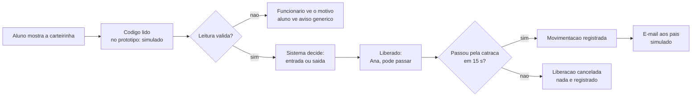

# Como o sistema vai funcionar

**Documentação:** Rascunho (resumo feito a partir dos documentos revisados) ·
**Atualizado em:** 21/10/2026

Este resumo conta, em linguagem simples, como o Furin Access será usado no dia a dia
da escola. As regras completas estão em
[`regras-de-negocio.md`](regras-de-negocio.md) e nos [RF](../requirements/rf/). Se este
resumo e esses arquivos discordarem, valem os arquivos detalhados.

Todos os nomes e dados dos exemplos são **fictícios**.

## 1. Quem usa

| Quem | O que faz | Tem conta? |
|---|---|---|
| **ATE** (Auxiliar Técnico de Educação) | Usa o sistema completo: portaria, cadastro, carteirinhas, registros manuais, presentes, histórico, relatórios e contas da equipe | **Sim**, perfil `FUNCIONARIO` |
| **Gestão Escolar** (Secretaria e Direção) | Usa o mesmo sistema completo que o ATE | **Sim**, perfil `FUNCIONARIO` |
| **Aluno** | Só apresenta a carteirinha na portaria | **Não** |
| **Pais/responsáveis** | Só recebem o e-mail de entrada e saída | **Não** |

O ATE e a Gestão Escolar são **cargos diferentes**, mas no sistema fazem as mesmas
coisas (DEC-37). Cada funcionário entra com usuário e senha próprios, e o sistema
registra quem fez cada ação.

## 2. Antes do primeiro dia: o cadastro

1. Um funcionário cadastra o aluno com **nome, matrícula, turma e foto**, todos
   obrigatórios.
2. Cadastra o **contato principal** (nome, telefone e e-mail), que vai receber os
   avisos.
3. Confere o **termo de consentimento** assinado pelo responsável e registra a versão
   (`v1-2026`), a data e a referência do documento.
4. O sistema emite a **carteirinha**, com um QR Code que contém só um código aleatório,
   sem dados pessoais. O funcionário imprime pela tela do navegador.

Sem o termo, o aluno **não** é cadastrado. Ele continua estudando normalmente, e a
escola controla a entrada e a saída dele como faz hoje, fora do sistema (DEC-34).

## 3. Na portaria: entrada e saída

Passo a passo:

1. O aluno apresenta a carteirinha.
2. O sistema lê o código. **No protótipo**, o funcionário digita ou cola o código, ou
   clica no aluno no painel **"Simular leitura"**, porque o grupo não tem leitor
   (DEC-25).
3. O sistema confere a leitura e **decide sozinho** se é entrada ou saída, pela última
   movimentação do aluno. O funcionário não escolhe nada.
4. A passagem é **liberada**:
   - o **funcionário** vê a foto, o nome, a turma e o tipo, para conferir quem está
     passando;
   - o **monitor do aluno** mostra só o primeiro nome: "Ana, entrada liberada. Pode
     passar."
5. O aluno passa pela catraca. **No protótipo**, o funcionário clica em **"Simular
   passagem (giro)"**.
6. Só então a movimentação é **registrada**, com a data e a hora da passagem.
7. Se ninguém passar em **15 segundos**, a liberação é cancelada e nada é registrado.
8. Tudo isso acontece em **até 2 segundos** depois da leitura.

**Proteções automáticas:**

- Ler o mesmo código de novo em até 2 segundos é ignorado.
- Enquanto um aluno não passa, outro aluno espera.
- Não existem duas entradas ou duas saídas seguidas para o mesmo aluno.
- Carteirinha revogada, aluno inativo ou código desconhecido: a leitura é recusada. O
  funcionário vê o motivo, e o aluno vê só "Não foi possível ler sua carteirinha. Tente
  de novo ou procure o funcionário da portaria".

## 4. Quando algo foge do normal: o registro manual

Exemplos: o aluno esqueceu a carteirinha, ou ontem saiu sem registrar a saída.

1. O funcionário busca o aluno pelo nome ou pela matrícula.
2. O sistema mostra se a movimentação será de entrada ou de saída.
3. O funcionário informa o **horário real** e o **motivo**, que é obrigatório.
4. O registro fica marcado como **manual** no histórico, com o motivo, a hora do
   lançamento e quem lançou.

**Toda entrada precisa de uma saída.** Se um aluno entrou ontem e não teve a saída
registrada, ele aparece em **"Saídas pendentes"**, e a próxima leitura dele é recusada
até um funcionário registrar a saída manual.

## 5. Durante o dia: presentes e merenda

O painel **Presentes**, que todo funcionário vê, mostra:

- o **total de alunos presentes agora**, contando só as entradas de hoje;
- o total **por turma**;
- as **saídas pendentes** de dias anteriores, que não entram na contagem.

O número ajuda a planejar a merenda. Ele **não** comprova presença em sala de aula, e
não inclui alunos sem termo, que a escola acompanha fora do sistema.

## 6. Os pais/responsáveis

- A cada entrada e saída registrada, o sistema prepara um **aviso por e-mail** para o
  contato principal, só com o primeiro nome, o tipo, a data, a hora e a forma. O e-mail
  **não tem link** para o sistema. No projeto, o envio é **sempre simulado**: a tela
  mostra "nenhum e-mail foi enviado" (DEC-32).
- Os pais **não têm conta** nem tela no sistema (DEC-37).
- Para deixar de receber os avisos, o responsável **pede à escola**. Um funcionário
  desliga a opção na edição do aluno, e o sistema registra quem mudou (DEC-38).

## 7. Histórico e relatórios

1. Qualquer funcionário abre o **histórico** e filtra por período (até 31 dias), turma
   ou aluno.
2. A tabela mostra data, hora, aluno, turma, tipo, forma (leitura ou manual), o motivo
   dos registros manuais e o status do aviso ao responsável.
3. A **versão para impressão** abre a mesma lista, sem menus, com até 1.000 registros e
   o aviso "uso restrito". A impressão e o PDF são feitos pelo próprio navegador.

## 8. Contas e senhas

Só existem contas de funcionários.

| Conta | Quem cria | Como recebe a senha |
|---|---|---|
| Primeiras contas (`ate.demo`, `gestao.demo` no protótipo) | Carga inicial do sistema | Fora do sistema |
| Novas contas da equipe | **Qualquer funcionário**, na tela "Contas da equipe" (DEC-39) | Senha temporária mostrada uma vez, entregue pessoalmente e de forma reservada |

Regras de senha e conta:

- A senha temporária tem 12 caracteres, vale 72 horas e precisa ser trocada.
- A nova senha precisa ter pelo menos 8 caracteres.
- Depois de 5 tentativas erradas, o login fica bloqueado por 15 minutos.
- A sessão expira depois de 30 minutos sem uso, com aviso 60 segundos antes.
- Qualquer funcionário pode desativar ou reativar a conta de outro, mas **ninguém
  desativa a própria conta**.

Senhas ficam guardadas só como hash (um resumo criptográfico que não permite recuperar a
senha), nunca em texto.

## 9. Proteção dos dados

- O sistema guarda **só** o necessário: nome, matrícula, turma, foto, contato do
  responsável, termo, movimentações e as contas dos funcionários. Não guarda CPF,
  endereço, data de nascimento ou biometria.
- Fotos e termos ficam numa **área privada**, que só funcionários autenticados acessam.
- O monitor do aluno mostra **só o primeiro nome**.
- Os dados são guardados por **5 anos** depois que o aluno sai da escola ou que o termo
  é revogado, e depois são apagados ou anonimizados (DEC-36).
- Se o termo for **revogado**, o aluno sai do sistema, a carteirinha deixa de valer e os
  avisos por e-mail param.
- Há um **backup** simples do banco e das fotos, com as 7 últimas cópias, guardado fora
  do projeto (DEC-30).

## 10. O que é simulado no protótipo

| O que | Como aparece no protótipo | Na vida real |
|---|---|---|
| Leitor de QR Code | Campo para digitar ou colar o código e painel "Simular leitura" | Leitor USB 2D na portaria |
| Catraca e giro | Botão "Simular passagem (giro)" | Sensor da catraca |
| E-mail aos responsáveis | Status "simulada" e aviso "nenhum e-mail foi enviado" | Envio por um provedor de e-mail |
| Monitor do aluno | Painel na mesma tela do funcionário | Segundo monitor voltado ao aluno |
| Hospedagem | Computador da equipe, sem endereço na internet | Servidor da escola com HTTPS |

Toda simulação aparece **identificada na tela** e só existe no modo protótipo.
