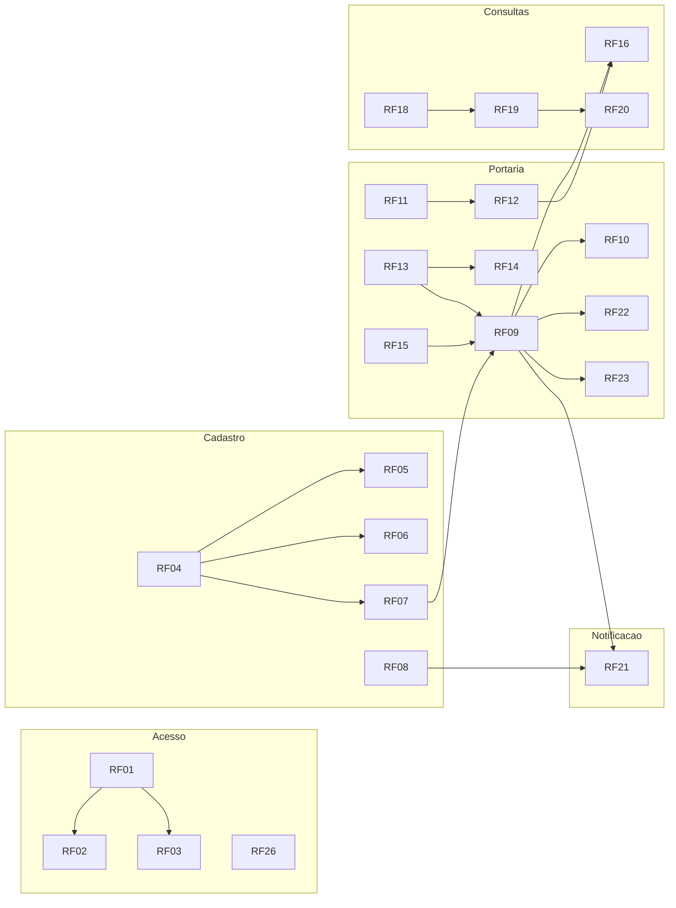

# Resumo dos requisitos funcionais

**Documentação:** Rascunho (resumo feito a partir dos documentos revisados) ·
**Atualizado em:** 21/10/2026

O Furin Access tem **26 IDs de requisitos funcionais**: os RF01 a RF23 vieram da
Atividade 8 e os RF24 a RF26 foram criados pelo grupo (DEC-13, DEC-15). Com o perfil
único `FUNCIONARIO` (DEC-37), **RF17, RF24 e RF25 saíram do escopo**: os arquivos
continuam, para não perder os IDs, mas não devem ser implementados. Ficam **23 RF a
implementar**.

Cada RF tem um arquivo próprio em [`requirements/rf/`](../requirements/rf/), com fluxo,
mensagens, dados e critérios de aceitação. **Se este resumo e um arquivo de RF
discordarem, vale o arquivo do RF.**

Hoje os RF do escopo estão com `Documentação: Revisada` e `Implementação: Planejada`.
A coluna "No protótipo" mostra a **meta** de cada um. Na coluna "Quem usa",
"Funcionário" quer dizer qualquer conta `FUNCIONARIO` (ATE ou Gestão Escolar).

## 1. Acesso

| RF | Título | O que faz | Quem usa | No protótipo |
|---|---|---|---|---|
| [RF01](../requirements/rf/RF01.md) | Autenticar o usuário com usuário e senha individuais | Login e logout. Troca obrigatória da senha temporária, alteração da própria senha e sessão de 30 min com aviso 60 s antes | Funcionário | Implementada |
| [RF02](../requirements/rf/RF02.md) | Bloquear o acesso com credenciais inválidas e exibir mensagem de erro | Mensagem única, sem dizer qual dado está errado. Bloqueio de 15 min depois de 5 erros | Funcionário | Implementada |
| [RF03](../requirements/rf/RF03.md) | Direcionar cada usuário às telas do seu perfil | Perfil único: todos caem na portaria e têm o mesmo menu. Sem login, só a tela de login. O servidor nega tudo que não foi liberado | Funcionário | Implementada |

## 2. Cadastro

| RF | Título | O que faz | Quem usa | No protótipo |
|---|---|---|---|---|
| [RF04](../requirements/rf/RF04.md) | Cadastrar aluno com nome, matrícula, turma, foto e contato principal | Cadastro em um formulário, com foto (JPEG ou PNG até 2 MB) e contato principal obrigatórios | Funcionário | Implementada |
| [RF05](../requirements/rf/RF05.md) | Exigir no cadastro a conferência do termo de consentimento assinado | Registra a evidência do termo (versão `v1-2026`, data, referência, conferente). Sem termo, não cadastra. A revogação tira o aluno do sistema | Funcionário | Implementada |
| [RF06](../requirements/rf/RF06.md) | Impedir cadastro com matrícula ou código de carteirinha duplicados | Bloqueia matrícula repetida e código de carteirinha repetido, inclusive em acessos simultâneos | Funcionário | Implementada |
| [RF07](../requirements/rf/RF07.md) | Gerar o QR Code do aluno para impressão da carteirinha | Código aleatório de 32 caracteres em QR Code. Carteirinha de 85,6 × 54 mm, segunda via revoga a anterior | Funcionário | Implementada |
| [RF08](../requirements/rf/RF08.md) | Editar os dados cadastrais do aluno | Edição com resumo antes de gravar. Troca de turma preserva o histórico. Inativação, registro da revogação do termo e **aviso por e-mail ligado ou desligado a pedido do responsável** (DEC-38) | Funcionário | Implementada |

## 3. Portaria

| RF | Título | O que faz | Quem usa | No protótipo |
|---|---|---|---|---|
| [RF09](../requirements/rf/RF09.md) | Registrar a entrada automaticamente após leitura e giro | Leitura válida → liberação → registro só depois do giro. Sem giro em 15 s, cancela | Funcionário, aluno | Leitura e giro **simulados** |
| [RF10](../requirements/rf/RF10.md) | Exibir ao ATE a foto, o nome e a turma do aluno após a leitura | Painel do funcionário com foto, nome, turma, tipo e situação. Limpa depois de 60 s sem leitura | Funcionário | Implementada |
| [RF11](../requirements/rf/RF11.md) | Buscar aluno por nome ou matrícula | Busca com até 20 resultados e pelo menos 2 caracteres do nome | Funcionário | Implementada |
| [RF12](../requirements/rf/RF12.md) | Registrar entrada ou saída manual excepcional, com motivo | Registro manual com horário real e motivo obrigatório (até 200 caracteres). O sistema define o tipo | Funcionário | Implementada |
| [RF13](../requirements/rf/RF13.md) | Determinar automaticamente o tipo de movimentação na leitura | O servidor decide entrada ou saída pela última movimentação confirmada. Não há seletor de modo | Sistema | Implementada |
| [RF14](../requirements/rf/RF14.md) | Registrar a saída automaticamente após leitura e giro | Mesmo fluxo do RF09, para a saída do mesmo dia | Funcionário, aluno | Leitura e giro **simulados** |
| [RF15](../requirements/rf/RF15.md) | Impedir movimentações repetidas ou fora de sequência | Janela de 2 s para o mesmo código, uma liberação por vez e nenhuma entrada ou saída repetida | Sistema | Implementada |
| [RF22](../requirements/rf/RF22.md) | Exibir no monitor do aluno o primeiro nome e a liberação ou confirmação | Monitor só com o primeiro nome e o estado, por 4 s | Aluno (sem conta) | Painel na mesma tela do funcionário |
| [RF23](../requirements/rf/RF23.md) | Exibir aviso quando a leitura falhar, orientando a tentar de novo ou procurar o ATE | Mensagem genérica ao aluno e motivo ao funcionário. Nada é gravado | Aluno, funcionário | Implementada |

Os títulos do RF10 e do RF23 citam o "ATE" porque vieram assim da Atividade 8. Hoje
eles valem para qualquer funcionário.

## 4. Consultas e relatórios

| RF | Título | O que faz | Quem usa | No protótipo |
|---|---|---|---|---|
| [RF16](../requirements/rf/RF16.md) | Exibir o total de presentes, o total por turma e as saídas pendentes | Presentes de hoje (total e por turma) e saídas pendentes de dias anteriores, com registro de saída manual a partir delas. Atualiza a cada 30 s | Funcionário | Implementada |
| [RF17](../requirements/rf/RF17.md) | Restringir o perfil de gestão a consultas *(fora do escopo)* | Não se aplica mais: a Gestão tem o mesmo perfil do ATE (DEC-37) | — | **Não implementar** |
| [RF18](../requirements/rf/RF18.md) | Consultar o histórico de entradas e saídas com filtro por período, turma ou aluno | Histórico com filtros, até 31 dias por consulta e 50 registros por página | Funcionário | Implementada |
| [RF19](../requirements/rf/RF19.md) | Exibir no histórico: aluno, turma, tipo, data, hora e forma de registro | Colunas da tabela, com motivo, lançamento e autor nos manuais e o status do aviso ao responsável | Funcionário | Implementada |
| [RF20](../requirements/rf/RF20.md) | Permitir a impressão do relatório pelo navegador | Versão para impressão com até 1.000 registros e rodapé "uso restrito" | Funcionário | Implementada |

## 5. Notificação e contas

| RF | Título | O que faz | Quem usa | No protótipo |
|---|---|---|---|---|
| [RF21](../requirements/rf/RF21.md) | Notificar o contato principal sobre a entrada e a saída do aluno | Aviso por e-mail depois de cada movimentação confirmada, com dados mínimos e sem link. O funcionário desliga a pedido do responsável | Sistema; pais recebem (sem conta) | E-mail **sempre simulado** |
| [RF24](../requirements/rf/RF24.md) *(fora do escopo)* | Consulta resumida do responsável | Não se aplica mais: os pais não têm conta (DEC-37) | — | **Não implementar** |
| [RF25](../requirements/rf/RF25.md) *(fora do escopo)* | Criar e vincular a conta do responsável | Não se aplica mais: os pais não têm conta (DEC-37) | — | **Não implementar** |
| [RF26](../requirements/rf/RF26.md) *(novo)* | Gerenciar contas da equipe | Qualquer funcionário cria, gera nova senha temporária, desativa e reativa contas `FUNCIONARIO`. Ninguém desativa a própria conta (DEC-39) | Funcionário | Implementada |

## 6. O que mudou em relação à Atividade 8

| RF | Mudança | Decisão |
|---|---|---|
| RF03 | Perfil único: mesma tela inicial e mesmo menu para ATE e Gestão | DEC-37 |
| RF13 | Título reescrito: antes era "Alternar o modo de leitura entre Entrada e Saída". Agora o tipo é automático | ATU-01, DEC-01 |
| RF09, RF14 | Liberação na leitura e registro só depois do giro. A US citada passou a ser a US11 | DEC-19 |
| RF12 | Ampliado para entrada **e** saída manual, com dois horários | DEC-03, DEC-20 |
| RF15 | Generalizado: antes só impedia duas saídas seguidas | DEC-02, DEC-04 |
| RF16 | Inclui as saídas pendentes. Toda a equipe vê | DEC-04, DEC-12, DEC-37 |
| RF17 | Fora do escopo | DEC-37 |
| RF21 | Só a notificação, sem link. A "verificação" chegou a virar o RF24, que saiu | ATU-02, DEC-15, DEC-37, DEC-38 |
| RF24, RF25 | Criados e depois retirados do escopo | DEC-15, DEC-37 |
| RF26 | Novo. Título atual: "Gerenciar contas da equipe" | DEC-13, DEC-39 |

A lista completa está em [`rastreabilidade.md`](rastreabilidade.md) §7.1.

## 7. Como os RF se encaixam

RF17, RF24 e RF25 ficam fora do diagrama porque estão fora do escopo.
